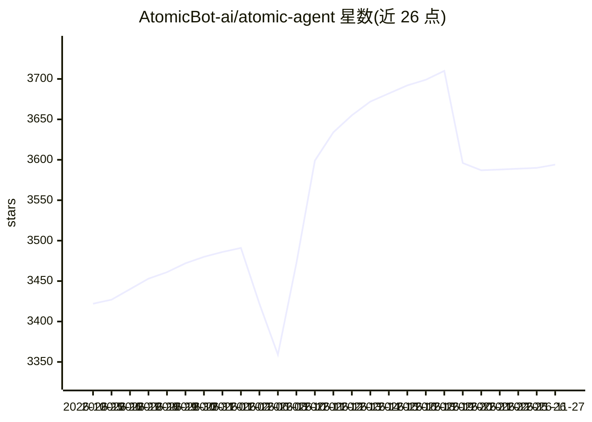

# AtomicBot-ai/atomic-agent

⭐ 3,594 · TypeScript · MIT · 推送 2026-11-26 · [GitHub](https://github.com/AtomicBot-ai/atomic-agent) · [官网](https://atomicagent.io) · 组织维护

**本机运行的 local-first AI agent：驱动浏览器、管理文件与命令**

以 CLI/TUI 形式提供的本地优先 AI agent，控制循环与状态都在用户机器上运行：可操作浏览器、读写文件、执行经批准的 shell 命令、跨会话记忆上下文、调度后续任务并通过 MCP 调用外部工具。默认基于 llama.cpp 跑小型量化模型（GGUF），也支持云模型或 Fusion 模式（一个模型规划、一组 worker 执行）。提供安装脚本、Linux 系统包与桌面应用，支持从 Claude Code、Codex、Hermes 等其他 agent 导入数据。README 标注为 Developer preview，API 与行为仍在变动。

## 筛选速览

| 维度 | 判定 | 备注 |
|---|---|---|
| AI 角色 | `ai-native` | 本体是模型或模型工具 |
| 许可风险 | `permissive` | MIT |
| 部署形态 | `desktop` | 安装包/桌面程序 |
| 模型依赖 | local-ok | 支持本地模型 |
| 硬件要求 | — | 无带数字的原话,不猜 |
| 安装摩擦 | `medium` | 含编译或系统依赖之一 |
| 成熟度 | `idea` | |

## 能力要点

- 控制循环与状态全部在本地，支持本地/云模型及 Fusion 混合模式
- 内置 llama.cpp 与 TurboQuant，长会话下小型量化模型占用更少内存
- 通过 MCP 调用外部工具，支持 HTTP 或 Tauri sidecar 嵌入自有应用
- 提供从 Claude Code/Codex/Hermes/OpenClaw 等迁移数据的导入功能

## 适用场景

- 在本机用小型开源权重模型跑多步 agent 任务
- 让 agent 自动化浏览器操作与文件整理
- 通过 HTTP/sidecar 把 agent 能力嵌入自己的应用
- 从其他 agent CLI 迁移会话、技能与记忆到本地环境

## 场景标签

`浏览器自动化` `AI 助手` · 领域:效率与自动化

## 证据(README 行号)

> L7: Drives your browser, edits files, runs approved commands, and remembers context across sessions. Open source, runnin
> L26: A local-first AI agent that runs the control loop and all state on your machine. It works across your machine: brow

## 星数曲线

2026-10-25 3,422 → 2026-11-27 3,594（+172）

---
*卡片 v1 · prompt 1.4 · 生成 2026-11-26 · 置信度 mid · 依据 README sha `8f25d4d629e7` · [字段定义](../../DATASET.md)*
