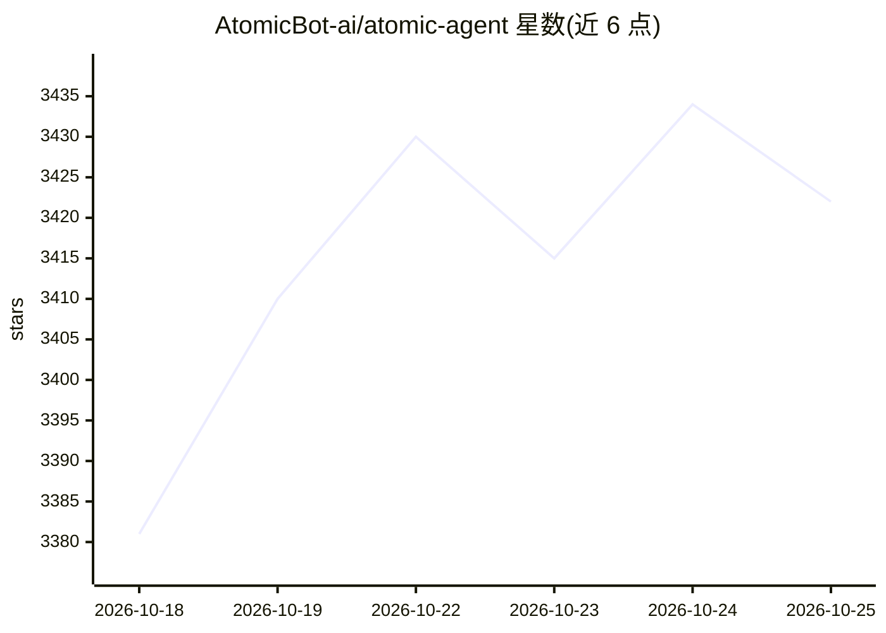

# AtomicBot-ai/atomic-agent

⭐ 3,427 · TypeScript · MIT · 推送 2026-10-25 · [GitHub](https://github.com/AtomicBot-ai/atomic-agent) · [官网](https://atomicagent.io) · 组织维护

**本地优先的 AI agent：在自己机器上跑开源模型操作浏览器与文件**

面向终端用户的本地优先 AI agent，控制循环与全部状态（会话、记忆、任务、痕迹）保存在本机磁盘。能力包括浏览器自动化（ARIA 紧凑视图）、文件读写与 shell 命令（危险操作需审批）、文档解析、Git 操作、MCP 外部工具与跨会话记忆。本地模型经自维护的 TurboQuant llama.cpp 运行（GBNF 约束工具调用、KV-cache 量化），也可接云端模型或双模型 Fusion 模式。以 curl/PowerShell 安装器分发 CLI 与 TUI，提供 macOS Apple Silicon、Linux x64/arm64、Windows x64 构建；当前为 developer preview，API 仍在变动。

## 筛选速览

| 维度 | 判定 | 备注 |
|---|---|---|
| AI 角色 | `ai-native` | 本体是模型或模型工具 |
| 许可风险 | `permissive` | MIT |
| 部署形态 | `library` | 以包/库形式分发 |
| 模型依赖 | local-ok | 支持本地模型 |
| 硬件要求 | — | 无带数字的原话,不猜 |
| 安装摩擦 | `medium` | 含编译或系统依赖之一 |
| 成熟度 | `idea` | |

## 能力要点

- 本地优先：控制循环与状态（SQLite/NDJSON 痕迹）全部在本机运行
- 自维护 TurboQuant llama.cpp：KV-cache 量化压缩内存，小模型可长会话运行
- GBNF 约束本地模型输出 JSON 工具调用数组，读操作并行、危险操作审批门控
- 支持从 Claude Code、Codex、Hermes、OpenClaw 等迁移数据

## 适用场景

- 在本机用小量化模型完成浏览网页、改文件、跑命令等长任务
- 不依赖云端服务、控制数据不出本机地使用 AI agent
- 把 agent 嵌入自己的应用（HTTP 或 Tauri sidecar）

## 场景标签

`AI 助手` `浏览器自动化` `文档解析` · 领域:效率与自动化

## 证据(README 行号)

> L5: ### A local-first AI agent that runs on your machine, with local or cloud models.
> L26: A local-first AI agent that runs the control loop and all state on your machine. It works across your machine: brow
> L181: We run local models on our own TurboQuant `llama.cpp` (`AtomicBot-ai/atomic-llama-cpp-turboquant-nightly`):

## 星数曲线

2026-10-18 3,381 → 2026-10-25 3,422（+41）

---
*卡片 v1 · prompt 1.4 · 生成 2026-10-21 · 置信度 mid · 依据 README sha `74badef8492f` · [字段定义](../../DATASET.md)*
