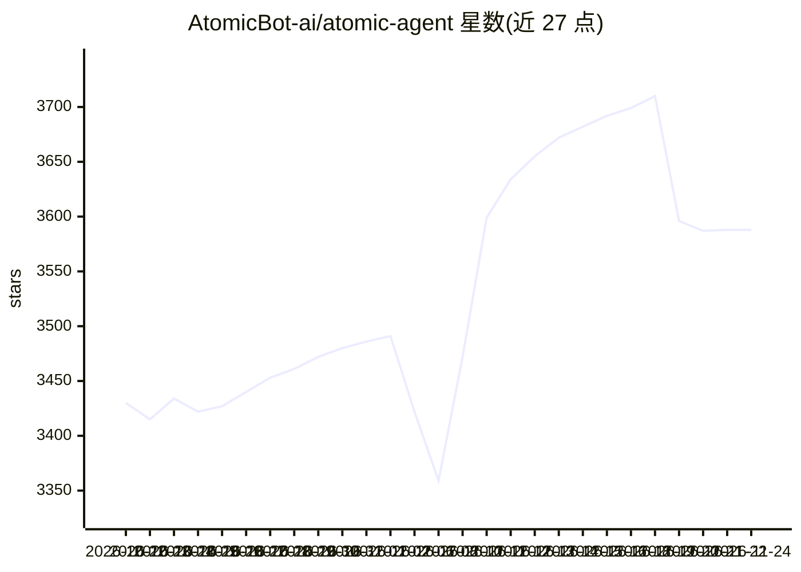

# AtomicBot-ai/atomic-agent

⭐ 3,589 · TypeScript · MIT · 推送 2026-11-23 · [GitHub](https://github.com/AtomicBot-ai/atomic-agent) · [官网](https://atomicagent.io) · 组织维护

**本机运行的 local-first AI agent：操控浏览器、文件与命令行**

控制循环与全部状态都在本机运行的 AI agent：浏览网页、读写文件、执行经批准的 shell 命令、检查文档、跨会话记忆上下文、定时任务，并通过 MCP 调用外部工具。可运行本地模型、云端模型或同时运行（Fusion 模式下一个模型规划、一组 worker 执行）。优先通过 llama.cpp 运行小型量化模型以适配消费级硬件长会话；提供 HTTP 与 Tauri sidecar 嵌入方式。状态保存在本地磁盘，本地模型下免费使用。

## 筛选速览

| 维度 | 判定 | 备注 |
|---|---|---|
| AI 角色 | `ai-native` | 本体是模型或模型工具 |
| 许可风险 | `permissive` | MIT |
| 部署形态 | `desktop` | 安装包/桌面程序 |
| 模型依赖 | local-ok | 支持本地模型 |
| 硬件要求 | — | 无带数字的原话,不猜 |
| 安装摩擦 | `medium` | 含编译或系统依赖之一 |
| 成熟度 | `idea` | |

## 能力要点

- 本地/云/Fusion 三种模型运行模式，经 llama.cpp 运行量化模型
- 浏览器自动化、文件编辑、已批准命令执行与 MCP 工具调用
- 支持从 Claude Code/Codex/Hermes 等六个 agent 导入既有数据
- 提供 CLI（atomic-agent/atag）与 Linux/macOS/Windows 桌面应用

## 适用场景

- 在本机离线运行 agent 处理浏览器自动化与文件操作
- 用小型本地模型在消费级硬件上跑长任务
- 从其他 agent 工具迁移会话、记忆与技能数据

## 场景标签

`浏览器自动化` `Agent 记忆` · 领域:Agent 开发

## 证据(README 行号)

> L5: ### A local-first AI agent that runs on your machine, with local or cloud models.
> L7: Drives your browser, edits files, runs approved commands, and remembers context across sessions. Open source, runnin
> L26: A local-first AI agent that runs the control loop and all state on your machine. It works across your machine: brow

## 星数曲线

2026-10-22 3,430 → 2026-11-24 3,588（+158）

---
*卡片 v1 · prompt 1.4 · 生成 2026-11-24 · 置信度 mid · 依据 README sha `b3a1f5fa5c15` · [字段定义](../../DATASET.md)*
