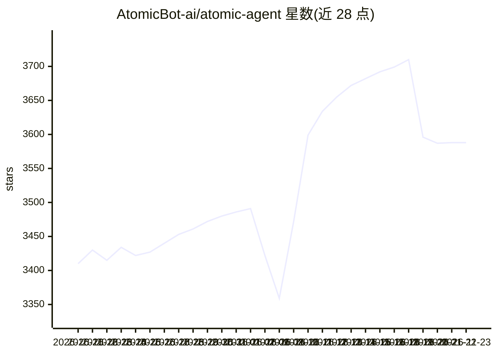

# AtomicBot-ai/atomic-agent

⭐ 3,588 · TypeScript · MIT · 推送 2026-11-22 · [GitHub](https://github.com/AtomicBot-ai/atomic-agent) · [官网](https://atomicagent.io) · 组织维护

**本地优先的 AI agent：浏览器、文件、命令、跨会话记忆**

在用户机器上运行控制循环与全部状态的终端 agent：可浏览网页、读写文件、执行经批准的 shell 命令、解析文档、跨会话记忆、定时跟进，并通过 MCP 调用外部工具。支持本地模型、云模型或 Fusion 模式（规划模型+工作者池）。基于内嵌的 TurboQuant llama.cpp 运行量化小模型。提供 CLI 与桌面应用两种形态，通过 HTTP 或 Tauri sidecar 嵌入自有应用。当前为 developer preview，API 与行为仍在变动。

## 筛选速览

| 维度 | 判定 | 备注 |
|---|---|---|
| AI 角色 | `ai-native` | 本体是模型或模型工具 |
| 许可风险 | `permissive` | MIT |
| 部署形态 | `desktop` | 安装包/桌面程序 |
| 模型依赖 | local-ok | 支持本地模型 |
| 硬件要求 | — | 无带数字的原话,不猜 |
| 安装摩擦 | `medium` | 含编译或系统依赖之一 |
| 成熟度 | `idea` | |

## 能力要点

- 本地/云模型或 Fusion 双模型模式（规划+工作者池）
- 内嵌 llama.cpp，量化小模型在消费级硬件上长会话运行
- 支持从 Claude Code/Codex/Hermes/OpenClaw 等导入既有数据
- GAIA L1 基准 69.8%（53 任务，自报数据）

## 适用场景

- 在本地机器上让 agent 浏览网页、整理文件、执行命令
- 用小尺寸量化模型跑多步骤长任务
- 把 agent 能力通过 HTTP/sidecar 嵌入自己的应用

## 场景标签

`浏览器自动化` `Agent 记忆` · 领域:Agent 开发

## 证据(README 行号)

> L7: Drives your browser, edits files, runs approved commands, and remembers context across sessions. Open source, runnin
> L26: A local-first AI agent that runs the control loop and all state on your machine. It works across your machine: brow
> L126: > Developer preview. APIs, commands, config, and behavior are still moving, so pin a release if you need a stable 

## 星数曲线

2026-10-21 3,410 → 2026-11-23 3,588（+178）

---
*卡片 v1 · prompt 1.4 · 生成 2026-11-23 · 置信度 mid · 依据 README sha `ae665f27c68b` · [字段定义](../../DATASET.md)*
