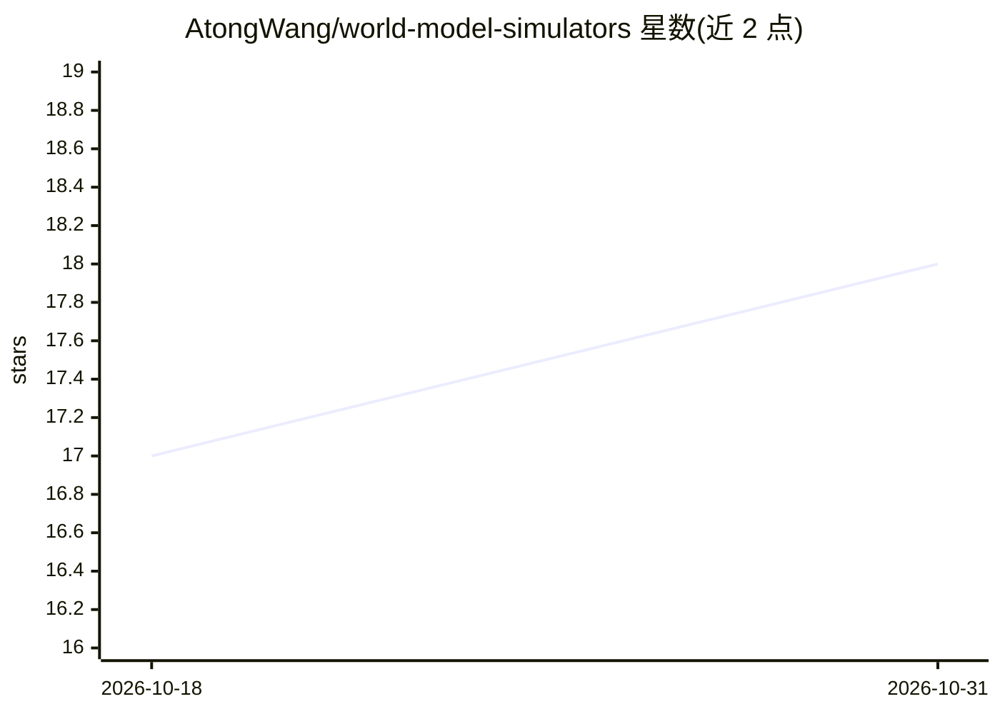

# AtongWang/world-model-simulators

⭐ 18 · MIT · 推送 2026-08-25 · [GitHub](https://github.com/AtongWang/world-model-simulators) · [官网](https://arxiv.org/abs/2608.23070) · 个人维护

**生成式世界模型论文清单：200 篇按 8 类模拟能力组织**

基于综述论文《From Generation to Simulation: How Far Are World Models from Being True Simulators?》构建的资源清单：收录 2018–2026 年间发表的 200 篇唯一论文，共 499 个 C1–C8 能力标签赋值（每篇 1–3 个主能力）。主列表按发表年份排序、每篇仅出现一次，八个能力分节构成反向索引，另设综述分节重新索引语料中的 16 篇综述。条目含发表信息与代码/项目链接，面向世界模型与具身智能方向的研究者。

## 筛选速览

| 维度 | 判定 | 备注 |
|---|---|---|
| AI 角色 | `ai-knowledge` | 知识聚合/清单类 |
| 许可风险 | `permissive` | MIT |
| 部署形态 | `None` |  |
| 模型依赖 | — | README 未给出锁定关系 |
| 硬件要求 | — | 无带数字的原话,不猜 |
| 安装摩擦 | `low` | 无编译、无系统依赖或容器化 |
| 成熟度 | — | 结构信号不足 |

## 能力要点

- 收录 200 篇唯一论文（2018–2026），含 499 个能力赋值
- 按传统模拟器的 8 项能力（C1–C8）组织反向索引
- 每条目附发表信息与 Code/Project 链接
- 综述分节单独索引 16 篇综述论文

## 适用场景

- 查找机器人操作、自动驾驶、具身智能方向的世界模型论文
- 按模拟器能力维度浏览研究图谱
- 定位论文的开源代码或项目主页

## 场景标签

`精选清单` · 领域:学习与行业

## 证据(README 行号)

> L3: A curated list of resources on generative world models as simulators, based on the comprehensive survey "From Genera
> L24: **How to read the counts.** This repository contains exactly **200 unique papers** and **499 C1–C8 capability assig

## 星数曲线

2026-10-18 17 → 2026-10-31 18（+1）

---
*卡片 v1 · prompt 1.4 · 生成 2026-10-30 · 置信度 high · 依据 README sha `e114b07aa7ee` · [字段定义](../../DATASET.md)*
