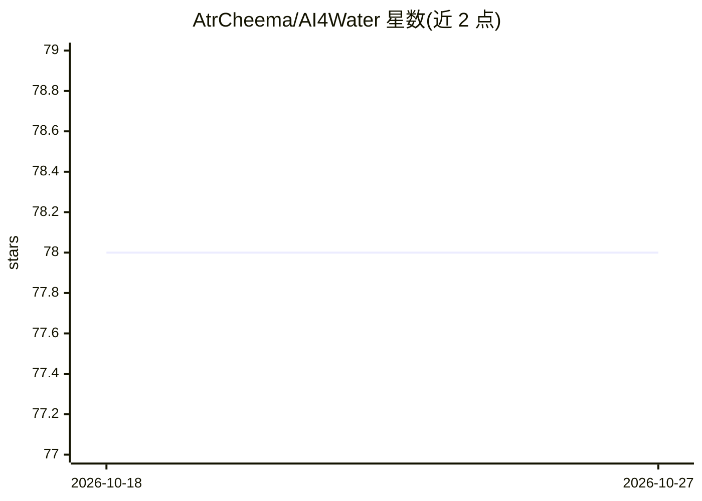

# AtrCheema/AI4Water

⭐ 78 · Python · MIT · 推送 2025-11-09 · [GitHub](https://github.com/AtrCheema/AI4Water) · [官网](https://ai4water.readthedocs.io) · 个人维护

**面向时序与表格数据的机器/深度学习建模框架**

Python 框架，用于快速构建与实验时间序列和表格数据的机器学习、深度学习模型：封装 keras/pytorch/sklearn，简化前处理与后处理，支持从 JSON 构建模型、通过字典定义分层模型，并提供 skopt、hyperopt、optuna 等多种超参数优化接口与实验对比子模块。通过 Model 类的 fit/predict/view_model 方法完成训练预测，可用 pip 安装并按 hpo、post_process、exp 等子模块可选依赖。文档声明库仍在开发中，可能发生不向后兼容的变更，ML 模型集成尚未完成。

## 筛选速览

| 维度 | 判定 | 备注 |
|---|---|---|
| AI 角色 | `ai-native` | 本体是模型或模型工具 |
| 许可风险 | `permissive` | MIT |
| 部署形态 | `library` | 以包/库形式分发 |
| 模型依赖 | — | README 未给出锁定关系 |
| 硬件要求 | — | 无带数字的原话,不猜 |
| 安装摩擦 | `low` | 无编译、无系统依赖或容器化 |
| 成熟度 | `idea` | |

## 能力要点

- 统一接口封装 keras/pytorch/sklearn，简化时序/表格数据前后处理
- 支持 skopt、hyperopt(tpe/atpe)、optuna(tpe/cmaes)、网格与随机搜索等超参优化
- 从 JSON 文件保存、加载与构建模型
- 实验子模块支持多模型对比与同模型不同条件对比

## 适用场景

- 我在做时序预测/分类任务，想减少样板代码快速跑通实验
- 我想用统一接口对多组超参数优化并批量对比模型
- 我想通过 JSON 配置保存和复现模型结构

## 场景标签

`MLOps` · 领域:训练与推理

## 证据(README 行号)

> L11: A uniform and simplified framework for rapid experimentation with deep leaning and machine learning based models
> L20: - compliment the functionality of `keras`/`pytorch`/`sklearn` by making pre and

## 星数曲线

2026-10-18 78 → 2026-10-27 78（+0）

---
*卡片 v1 · prompt 1.4 · 生成 2026-10-24 · 置信度 high · 依据 README sha `fcbc1b64a6f8` · [字段定义](../../DATASET.md)*
