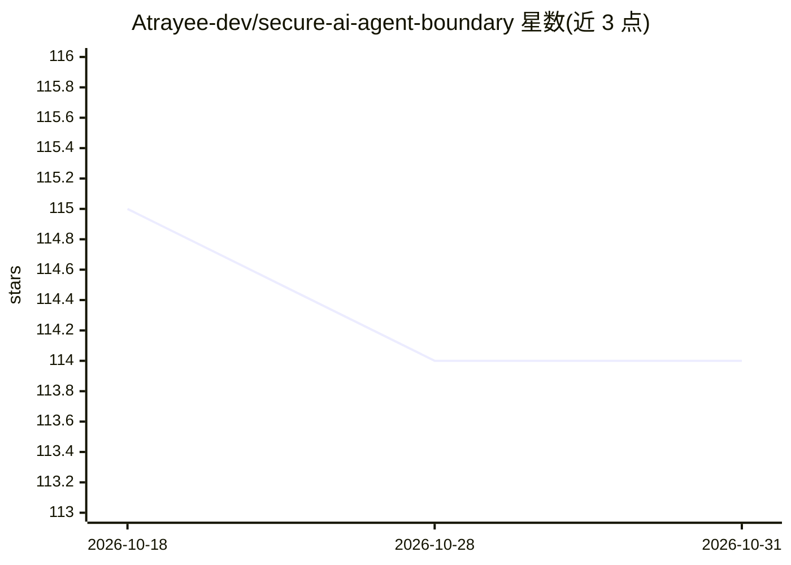

# Atrayee-dev/secure-ai-agent-boundary

⭐ 114 · HTML · 推送 2026-10-30 · [GitHub](https://github.com/Atrayee-dev/secure-ai-agent-boundary) · 组织维护

**面向高保障工程团队的零信任 AI 协作数据边界治理框架**

CodeBoundary 是一个位于源代码与 AI 模型（远程前沿 API 或本地开源模型）之间的工程治理层：通过 YAML/JSON 数据边界契约声明模型可读取的目录、文件与符号，配套密钥脱敏引擎、暂存区输出（工程师显式批准后才写入代码库）、不可变审计日志与边界违规拦截。支持本地低敏感任务与云端高复杂度任务的混合路由，理解 12+ 语言的语法树边界。入口为仓库根目录的 .codeboundary.yml，与编辑器无关，可被 CI 流水线在仓库级强制执行。声明为安全增强框架而非安全保证。

## 筛选速览

| 维度 | 判定 | 备注 |
|---|---|---|
| AI 角色 | `ai-ecosystem` | LLM/agent 周边工具 |
| 许可风险 | `none` | — |
| 部署形态 | `None` |  |
| 模型依赖 | — | README 未给出锁定关系 |
| 硬件要求 | — | 无带数字的原话,不猜 |
| 安装摩擦 | `low` | 无编译、无系统依赖或容器化 |
| 成熟度 | — | 结构信号不足 |

## 能力要点

- YAML/JSON 数据边界契约定义模型可见范围、脱敏规则与写权限模式
- 12+ 编程语言的语法树级边界检查与跨文件上下文推断阻断
- 本地/云端模型混合路由，切换时自动剥离并重水化上下文
- 暂存区输出与不可变审计日志，可由 CI 在仓库级强制执行

## 适用场景

- 在涉及专有代码的组织中限制 AI 编程助手可见的数据范围
- 按敏感度将任务路由到本地或云端模型并保留完整审计记录
- 在 CI 流水线中对无人值守的模型调用强制执行访问契约

## 场景标签

`网络安全` · 领域:学习与行业

## 证据(README 行号)

> L10: **CodeBoundary** is a domain-isolated, data-boundary architecture for high-assurance software engineering teams tha
> L20: This is not yet another "AI wrapper" for code editors. This is an **engineering governance layer** that sits betwee

## 星数曲线

2026-10-18 115 → 2026-10-31 114（-1）

---
*卡片 v1 · prompt 1.4 · 生成 2026-10-23 · 置信度 high · 依据 README sha `8c1dba0fb732` · [字段定义](../../DATASET.md)*
