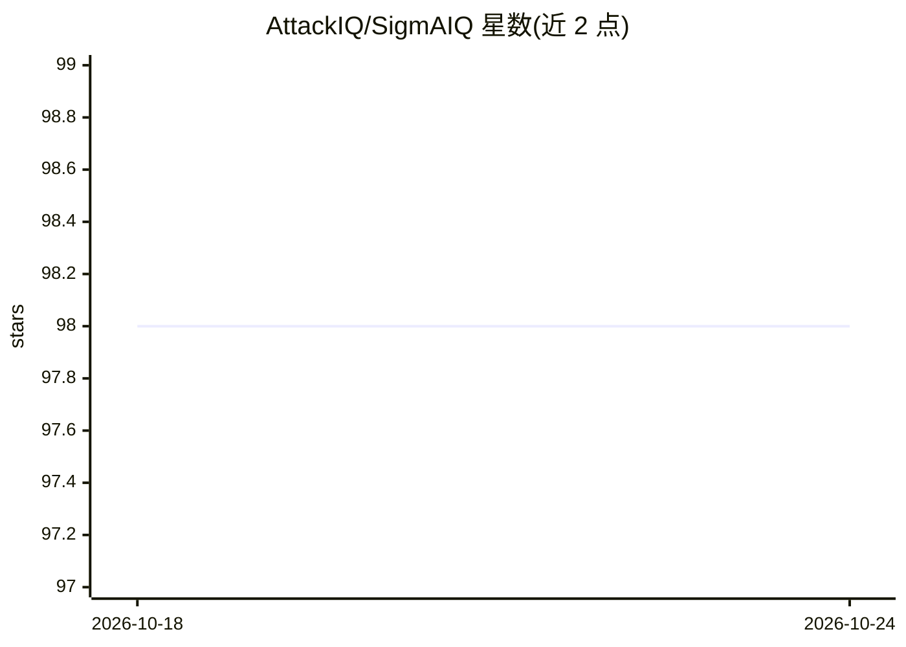

# AttackIQ/SigmAIQ

⭐ 98 · Python · LGPL-2.1 · 推送 2025-11-03 · [GitHub](https://github.com/AttackIQ/SigmAIQ) · [官网](https://attackiq.com) · 组织维护

**给检测工程师的 pySigma 封装：Sigma 规则自动转换与 LLM 生成**

面向检测工程师的 Python 库，封装 pySigma 及其各后端/管线，将 Sigma 规则转换为 SIEM/EDR 查询（Splunk、Elasticsearch、Microsoft Sentinel 等 18 种后端、多种输出格式），自动应用正确管线，并提供 SigmAIQ 自有管线与输出格式。另含 Sigma 规则搜索、LLM 支持（LangChain 工具包）与从 IOC 自动生成规则。目前处于 pre-release 状态，pySigma 工具/脚本尚未随预发布版本提供。由 AttackIQ 维护。

## 筛选速览

| 维度 | 判定 | 备注 |
|---|---|---|
| AI 角色 | `ai-ecosystem` | LLM/agent 周边工具 |
| 许可风险 | `viral` | LGPL-2.1 |
| 部署形态 | `desktop` | 安装包/桌面程序 |
| 模型依赖 | — | README 未给出锁定关系 |
| 硬件要求 | — | 无带数字的原话,不猜 |
| 安装摩擦 | `low` | 无编译、无系统依赖或容器化 |
| 成熟度 | `idea` | |

## 能力要点

- 18 种后端的 Sigma 规则到 SIEM/EDR 查询转换，自动应用处理管线
- 含 LLM 支持与从 IOC 自动创建 Sigma 规则
- create_all_and_translate 一次生成所有后端/管线/输出格式的查询
- SigmAIQ 自定义管线与输出格式（原后端未提供）

## 适用场景

- 把 Sigma 规则批量转换为多个 SIEM/EDR 的查询语言
- 用 LLM 辅助编写 Sigma 规则或从 IOC 生成规则
- 按字段映射管线适配不同数据源的字段名

## 场景标签

`网络安全` · 领域:学习与行业

## 证据(README 行号)

> L19: SigmAIQ is a wrapper for pySigma and pySigma backends & pipelines. It allows
> L29: Sigma rule searching, LLM support, an automatic rule creation from IOCs.
> L43: For LLM usage, see the LLM README

## 星数曲线

2026-10-18 98 → 2026-10-24 98（+0）

---
*卡片 v1 · prompt 1.4 · 生成 2026-10-23 · 置信度 high · 依据 README sha `0f5033218e9d` · [字段定义](../../DATASET.md)*
