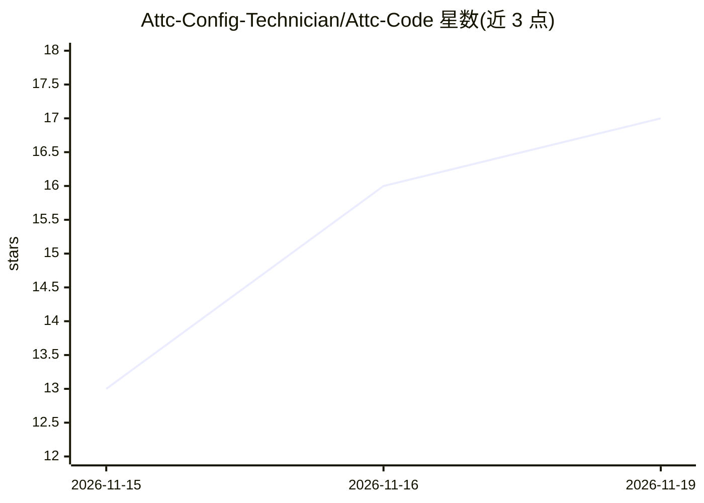

# Attc-Config-Technician/Attc-Code

⭐ 17 · C · GPL-3.0 · 推送 2026-11-16 · [GitHub](https://github.com/Attc-Config-Technician/Attc-Code) · [官网](https://attc-config-technician.github.io/Attc-Code/) · 个人维护

**在安卓手机上运行 Ubuntu 24.04 与五个 AI 编程 CLI 的终端应用**

Android 终端应用，通过 proot 在无 root 环境下启动真实 Ubuntu 24.04 arm64 用户空间，内置 apt、Python、Node、Git 与编译器。启动时可在 Attc Code（opencode + Zen 模型）、Claude Code（经应用内网关）、Codex、Kimi Code、Antigravity 与普通 shell 之间选择。附带离线 MFCC+DTW 唤醒词与土耳其语语音输入、Shizuku 手机控制桥（attc-ctl）、PTY 终端视图。限制：仅 arm64、Android 8.0+，proot 非模拟器，部分内核功能受限。

## 筛选速览

| 维度 | 判定 | 备注 |
|---|---|---|
| AI 角色 | `ai-ecosystem` | LLM/agent 周边工具 |
| 许可风险 | `viral` | GPL-3.0 |
| 部署形态 | `None` |  |
| 模型依赖 | locked-api |  |
| 硬件要求 | — | 无带数字的原话,不猜 |
| 安装摩擦 | `low` | 无编译、无系统依赖或容器化 |
| 成熟度 | — | 结构信号不足 |

## 能力要点

- proot 启动真实 Ubuntu 24.04 arm64 用户空间，无需 root
- 内置五个 AI 编程 CLI 可选启动（Claude Code/Codex/Kimi Code 等）
- 离线 "Hey Attc" 唤醒词：三次录音训练 MFCC+DTW 模型，全程本地
- attc-ctl + Shizuku 桥让 agent 控制手机（开应用、点击、截图）

## 适用场景

- 不带电脑时在手机上用 AI 编程 CLI 写代码
- 在安卓设备上获得可 apt 安装软件的 Ubuntu 环境
- 语音唤醒并输入命令到当前 CLI 会话
- 让 AI agent 操作手机应用与媒体控制

## 场景标签

`编码 Agent` `GUI 自动化` · 领域:效率与自动化

## 证据(README 行号)

> L22: Attc Code boots a real **Ubuntu 24.04 arm64** userland on your phone with proot. Inside it, you can run the AI codi
> L36: |**Claude Code**|Anthropic's coding CLI through the in-app gateway|

## 星数曲线

2026-11-15 13 → 2026-11-19 17（+4）

---
*卡片 v1 · prompt 1.4 · 生成 2026-11-18 · 置信度 high · 依据 README sha `da7252769a2a` · [字段定义](../../DATASET.md)*
