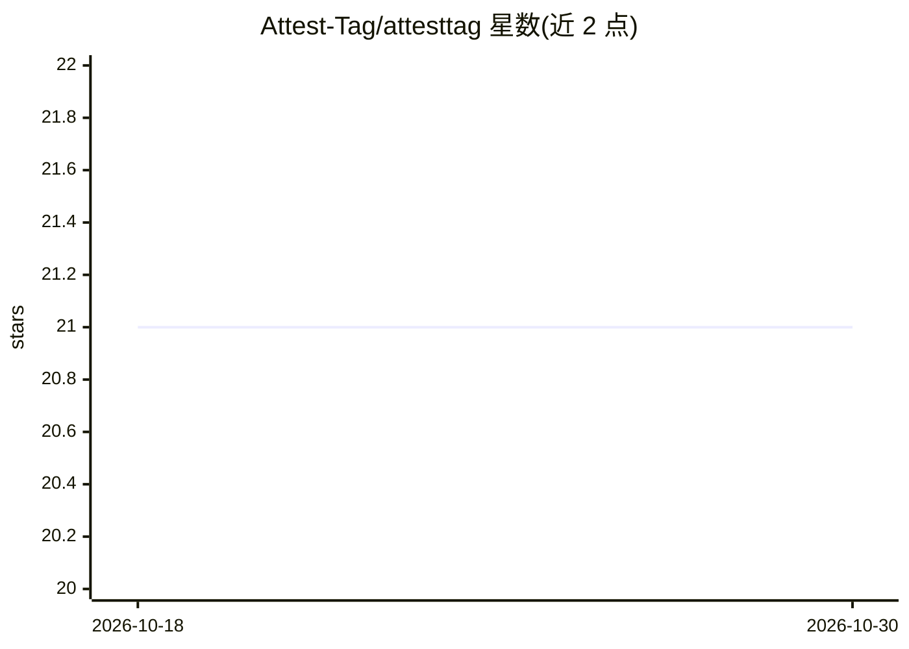

# Attest-Tag/attesttag

⭐ 21 · Go · MIT · 推送 2026-10-22 · [GitHub](https://github.com/Attest-Tag/attesttag) · [官网](https://attesttag.com) · 组织维护

**面向 Slack/Teams 的可自托管 AI 队友，跑开源权重模型**

单一 Go 二进制部署的 AI 助手 bot，接入 Slack 与 Microsoft Teams，通过任意 OpenAI 兼容端点调用开源权重模型（默认 OpenRouter + GLM-5.3-Flash）。用户 @提及或私信后，它读取线程上下文、调用工具（Slack 历史/搜索、文档 RAG、web、GitHub/ClickUp 等外部服务）、流式回答、维护记忆与定时任务。凭据由代理在边缘注入，模型不可见；写操作默认需人工确认按钮。内置 /admin/ 管理控制台、开发者 API 与 MCP server；SQLite 默认、可选 Postgres；提供 Docker、Helm 及多云脚本部署。代码修复与 PR 审查功能不在 GitHub 上写任何内容，除非管理员设为 Live。

## 筛选速览

| 维度 | 判定 | 备注 |
|---|---|---|
| AI 角色 | `ai-native` | 本体是模型或模型工具 |
| 许可风险 | `permissive` | MIT |
| 部署形态 | `self-host` | docker 或自建部署 |
| 模型依赖 | locked-api |  |
| 硬件要求 | — | 无带数字的原话,不猜 |
| 安装摩擦 | `low` | 无编译、无系统依赖或容器化 |
| 成熟度 | `idea` | |

## 能力要点

- 单一 Go 二进制含内嵌管理控制台，SQLite 默认/Postgres 可选
- 凭据密封并由代理注入，模型永远看不到密钥；写操作需人工确认
- 支持 Slack 与 Microsoft Teams，工具覆盖历史搜索、文档 RAG、web、外部服务、MCP
- 提供开发者 API 与 MCP server，可用 Docker/Helm/多云脚本部署

## 适用场景

- 团队在 Slack/Teams 中 @提及获取带工具调用与 RAG 的回答
- 自托管一个凭据隔离、写操作需确认的内部 AI 助手
- 让它在独立容器中修代码并开草稿 PR、对 PR 做审查评论

## 场景标签

`AI 助手` `RAG` `编码 Agent` `代码审查` · 领域:编码与开发

## 证据(README 行号)

> L9: An AI teammate for Slack — and for Microsoft Teams beside it — that runs on open-weight models
> L10: through any OpenAI-compatible endpoint (OpenRouter + GLM-5.3-Flash by default). One Go binary
> L14: People @mention it or DM it. It reads the thread, calls tools — Slack history and search,

## 星数曲线

2026-10-18 21 → 2026-10-30 21（+0）

---
*卡片 v1 · prompt 1.4 · 生成 2026-10-28 · 置信度 high · 依据 README sha `568b2371a0a6` · [字段定义](../../DATASET.md)*
