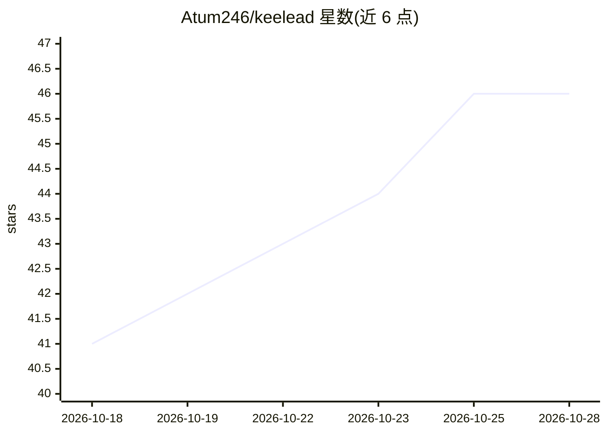

# Atum246/keelead

⭐ 46 · TypeScript · MIT · 推送 2026-04-28 · [GitHub](https://github.com/Atum246/keelead) · 个人维护

**自托管的 B2B 线索挖掘平台：62 数据源+AI 对话+邮箱验证**

MIT 许可的 Next.js 自托管销售线索生成平台（KeeLead）。从 62 个数据源（35 个免 API key，含 OpenStreetMap、SEC EDGAR、GitHub 等；27 个付费源可选）检索线索，提供 10 层邮箱验证（语法/DNS/MX/SMTP/一次性邮箱检测等，输出 0-100 分）、公司调研、Playwright 浏览器自动化、看板管线、营销活动与 7 格式导出。AI 部分：多提供商（OpenAI/Claude/Ollama/Groq/OpenRouter 等）对话界面用于自然语言检索线索，内置 MCP 服务器向外部 agent 暴露 5 个函数调用工具。AI 聊天至少需一个提供商 key，35 个免费数据源与邮箱验证无需任何 key 即可用。SQLite 存储，支持 Docker 与源码部署。

## 筛选速览

| 维度 | 判定 | 备注 |
|---|---|---|
| AI 角色 | `ai-enhanced` | 去掉 AI 部分产品仍成立 |
| 许可风险 | `permissive` | MIT |
| 部署形态 | `self-host` | docker 或自建部署 |
| 模型依赖 | local-ok | 支持本地模型 |
| 硬件要求 | — | 无带数字的原话,不猜 |
| 安装摩擦 | `low` | 无编译、无系统依赖或容器化 |
| 成熟度 | — | 结构信号不足 |

## 能力要点

- 62 个数据源（35 个无需 API key）聚合检索线索
- 10 层邮箱验证，输出 0-100 评分与明细
- 内置 MCP 服务器，向 AI agent 暴露 5 个函数调用工具
- GDPR/CAN-SPAM 合规工具、DNC 名单与审计日志

## 适用场景

- 销售团队自托管替代付费线索平台，聚合多数据源找客户
- 通过自然语言对话让 AI 从 62 个源里检索和丰富线索
- 批量验证邮箱有效性与合规性后再发起外联
- 让外部 AI agent 通过 MCP 调用线索搜索与企业调研能力

## 场景标签

`网页抓取` · 领域:效率与自动化

## 证据(README 行号)

> L7:  A free, open-source, self-hosted lead generation platform powered by AI with 62 data sources.
> L84: ### What Works Immediately (No API Keys!)
> L92: - 🤖 AI chat (at least one provider needed)
> L376: KeeLead includes a built-in MCP (Model Context Protocol) server for AI agent integration.

## 星数曲线

2026-10-18 41 → 2026-10-28 46（+5）

---
*卡片 v1 · prompt 1.4 · 生成 2026-10-25 · 置信度 mid · 依据 README sha `c41b17bcb963` · [字段定义](../../DATASET.md)*
