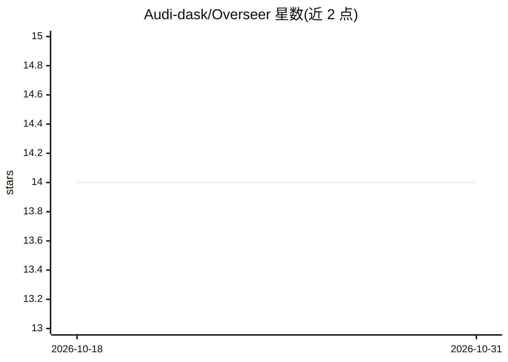

# Audi-dask/Overseer

⭐ 14 · Go · AGPL-3.0 · 推送 2026-08-28 · [GitHub](https://github.com/Audi-dask/Overseer) · 个人维护 · 中文 README

**自托管 AI Code Review 平台：自动审查 GitLab MR/Push 并回填评论**

面向企业内网部署的代码审查服务：通过 Webhook 对接 GitLab（GitHub/Gitea 规划中），监听 MR 或 Push 事件，在浅克隆工作区运行具备文件读取与代码搜索能力的 Agent 审查，支持自定义提示词与路径防火墙，结果以 MR 总评、行内 discussion 或 commit 评论回填，并可推送飞书卡片或通用 Webhook。LLM 可插拔，支持本地模型以满足数据合规。以 Docker Compose 方式部署，要求设置固定 MASTER_KEY 加密凭证，明确声明不可直接暴露公网。

## 筛选速览

| 维度 | 判定 | 备注 |
|---|---|---|
| AI 角色 | `ai-native` | 本体是模型或模型工具 |
| 许可风险 | `viral` | AGPL-3.0 |
| 部署形态 | `self-host` | docker 或自建部署 |
| 模型依赖 | — | README 未给出锁定关系 |
| 硬件要求 | — | 无带数字的原话,不猜 |
| 安装摩擦 | `low` | 无编译、无系统依赖或容器化 |
| 成熟度 | — | 结构信号不足 |

## 能力要点

- Webhook 驱动的 MR/Push 触发 Agent 审查（文件读取、代码搜索、路径防火墙）
- 审查结果回填 MR 总评与行内 discussion，Push 事件回填 commit 评论
- 飞书 interactive 卡片与通用 JSON Webhook 通知
- Docker Compose 部署，MASTER_KEY 加密 VCS Token 与 LLM Key

## 适用场景

- 私有化部署 AI 代码审查，覆盖 GitLab MR 与 Push 事件
- 敏感仓库使用本地或企业模型服务完成合规审查
- 审查结果推送到飞书或自有 Webhook 做团队通知

## 场景标签

`代码审查` · 领域:编码与开发

## 证据(README 行号)

> L7: Self-hosted code review for merge requests and push events — webhook-driven, pluggable LLMs, agent-based review, Git
> L13: Overseer connects to GitLab (more VCS providers planned), watches MR or Push events, runs an agent review against a
> L27: |Review|Agent with file read / code search; custom prompts; path firewall|

## 星数曲线

2026-10-18 14 → 2026-10-31 14（+0）

---
*卡片 v1 · prompt 1.4 · 生成 2026-10-31 · 置信度 high · 依据 README sha `07b64f9d9b77` · [字段定义](../../DATASET.md)*
