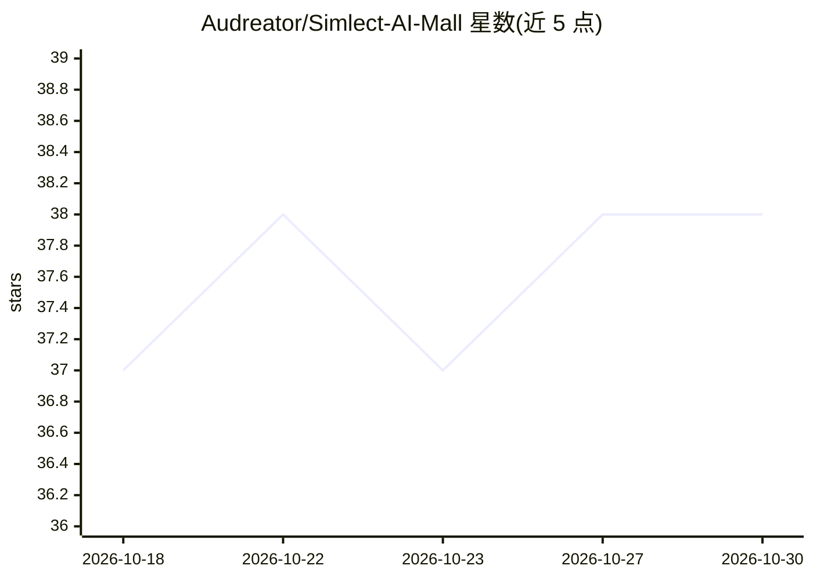

# Audreator/Simlect-AI-Mall

⭐ 38 · Java · MIT · 推送 2026-10-11 · [GitHub](https://github.com/Audreator/Simlect-AI-Mall) · [官网](https://www.simlect.com) · 个人维护 · 中文 README

**带对话导购与智能客服的 B2C 电商全栈平台**

单商家 B2C 电商在线平台：Java 侧以 Spring Cloud 拆分商品、订单、支付、营销、库存等 11 个微服务，Vue 3 提供 C 端与管理端。AI 部分为独立 Python Agent 进程，经 LangGraph 编排 LLM 与 10 个 MCP 业务工具：读操作（搜商品、查订单/物流）直接返回，写操作走「提案→用户确认→Java 执行」闭环，模型不直改业务库。搜索采用 ES 关键词+向量 RRF 与 FAQ 检索。本地部署需 JDK 17、Docker、Node.js 20+、Python 3.11 与 LLM API Key，建议内存≥16GB。

## 筛选速览

| 维度 | 判定 | 备注 |
|---|---|---|
| AI 角色 | `ai-enhanced` | 去掉 AI 部分产品仍成立 |
| 许可风险 | `permissive` | MIT |
| 部署形态 | `self-host` | docker 或自建部署 |
| 模型依赖 | — | README 未给出锁定关系 |
| 硬件要求 | — | 无带数字的原话,不猜 |
| 安装摩擦 | `low` | 无编译、无系统依赖或容器化 |
| 成熟度 | — | 结构信号不足 |

## 能力要点

- Python Agent 经 LangGraph 编排 10 个 MCP 工具（6 读/4 写提案），流式 WebSocket 输出
- 写操作走提案→用户确认→Java 执行闭环，Lua CAS 原子落定防重复执行
- ES 关键词+向量 RRF 混合搜索、FAQ 向量检索、商品变更 MQ 异步入库
- MySQL 行锁/Lua 原子操作防超卖、RabbitMQ TTL/DLX 超时关单、支付宝异步回调

## 适用场景

- 搭建带对话导购与智能客服的单商家电商系统
- 学习 Spring Cloud 微服务与 Python Agent（MCP）协作的架构实现
- 在对话中完成商品搜索、订单查询、退款评价等售后流程

## 场景标签

`聊天机器人` · 领域:对话与助手

## 证据(README 行号)

> L5: B2C 单商家电商在线平台。面向“只能手动搜商品”的传统体验，把**对话导购、混合搜索与可执行智能客服**融入电商全流程：浏览、咨询、下单、售后均可在对话里完成读操作，写操作经“提案 -> 用户确认 -> Java 执行”闭环，模型
> L7: Java 侧按领域拆成商品、订单、支付、营销（优惠券）、库存等微服务，基于 Spring Cloud 协作；智能客服为 **Python Agent 独立进程**，经 Gateway 统一对外。
> L15: |**AI + 传统电商**|LangGraph 编排 LLM + 10 个业务工具（6 读 / 4 写提案）；**自主规划**优先，少强制调工具；流式 WebSocket（复用站内通知）；商品/订单卡片由前端结构化渲染|

## 星数曲线

2026-10-18 37 → 2026-10-30 38（+1）

---
*卡片 v1 · prompt 1.4 · 生成 2026-10-25 · 置信度 high · 依据 README sha `46b6a99f1d1a` · [字段定义](../../DATASET.md)*
