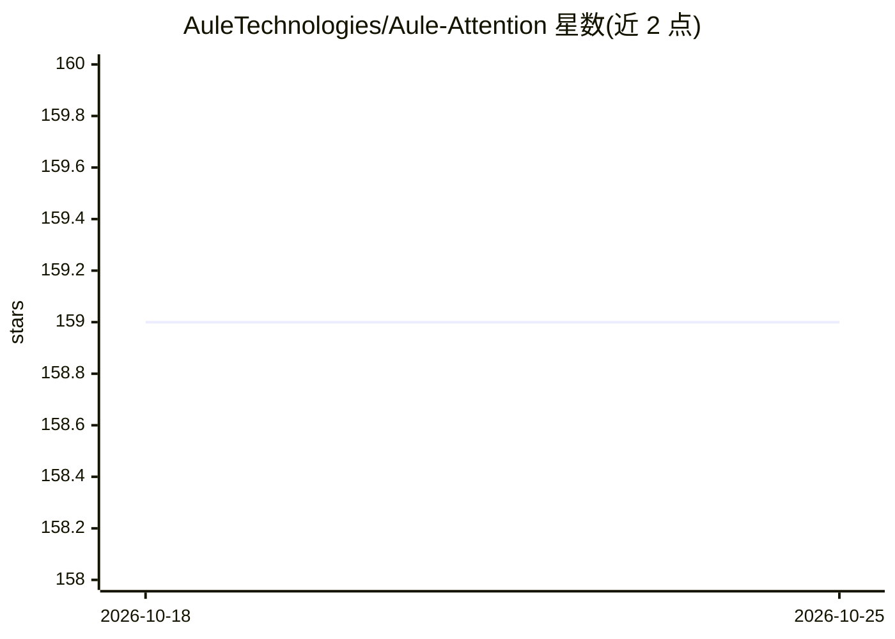

# AuleTechnologies/Aule-Attention

⭐ 160 · Zig · 推送 2026-01-27 · [GitHub](https://github.com/AuleTechnologies/Aule-Attention) · [官网](https://auletechnologies.com) · 组织维护

**跨厂商 GPU 的 FlashAttention-2 实现库，免编译即装即用**

以 pip 包形式提供的 FlashAttention-2 实现，面向 PyTorch 开发者，可作为 scaled_dot_product_attention 的替代。安装时无需编译，运行时按硬件自动选择后端：Triton（AMD ROCm 与 NVIDIA CUDA，支持训练反向传播与推理）、Vulkan（Intel/Apple/AMD 消费级 GPU 及任意 Vulkan 1.2+ 设备，经预编译 SPIR-V 着色器做推理）、CPU（NumPy 回退）。支持 GQA/MQA、float16/bfloat16/float32；限制包括 Triton 后端 head_dim≤128、Vulkan 后端≤64。源码用 Zig 编写，构建需 Zig 0.13+ 与 Vulkan SDK。

## 筛选速览

| 维度 | 判定 | 备注 |
|---|---|---|
| AI 角色 | `ai-ecosystem` | LLM/agent 周边工具 |
| 许可风险 | `none` | — |
| 部署形态 | `library` | 以包/库形式分发 |
| 模型依赖 | — | README 未给出锁定关系 |
| 硬件要求 | — | 无带数字的原话,不猜 |
| 安装摩擦 | `medium` | 含编译或系统依赖之一 |
| 成熟度 | — | 结构信号不足 |

## 能力要点

- Triton/Vulkan/CPU 三后端自动选择，无需安装时编译
- Triton 后端支持训练（反向梯度），覆盖 AMD MI300X/MI250/MI100 与 NVIDIA H100/A100 等
- Vulkan 后端通过预编译 SPIR-V 着色器支持 Intel Arc、Apple Silicon（MoltenVK）、AMD RDNA2/3 推理
- 支持 GQA/MQA 与 float16/bfloat16/float32，内存复杂度 O(N)

## 适用场景

- 在 AMD/Intel/Apple GPU 上为 LLM 训练或推理提供 FlashAttention 内核
- 替换 PyTorch SDPA 以在不依赖 CUDA 的硬件上运行注意力计算
- 消费级 GPU（如 Intel Arc、Apple M 系列）上做长序列推理

## 场景标签

 · 领域:深度学习基础设施/GPU 内核

## 证据(README 行号)

> L17: aule-attention provides a drop-in FlashAttention implementation that works across all major GPU vendors without req
> L19: - **Triton**: For AMD ROCm and NVIDIA CUDA (training and inference)
> L20: - **Vulkan**: For Intel, Apple, AMD consumer GPUs, and any Vulkan-capable device (inference)

## 星数曲线

2026-10-18 159 → 2026-10-25 159（+0）

---
*卡片 v1 · prompt 1.4 · 生成 2026-10-22 · 置信度 high · 依据 README sha `e975ee03daa0` · [字段定义](../../DATASET.md)*
