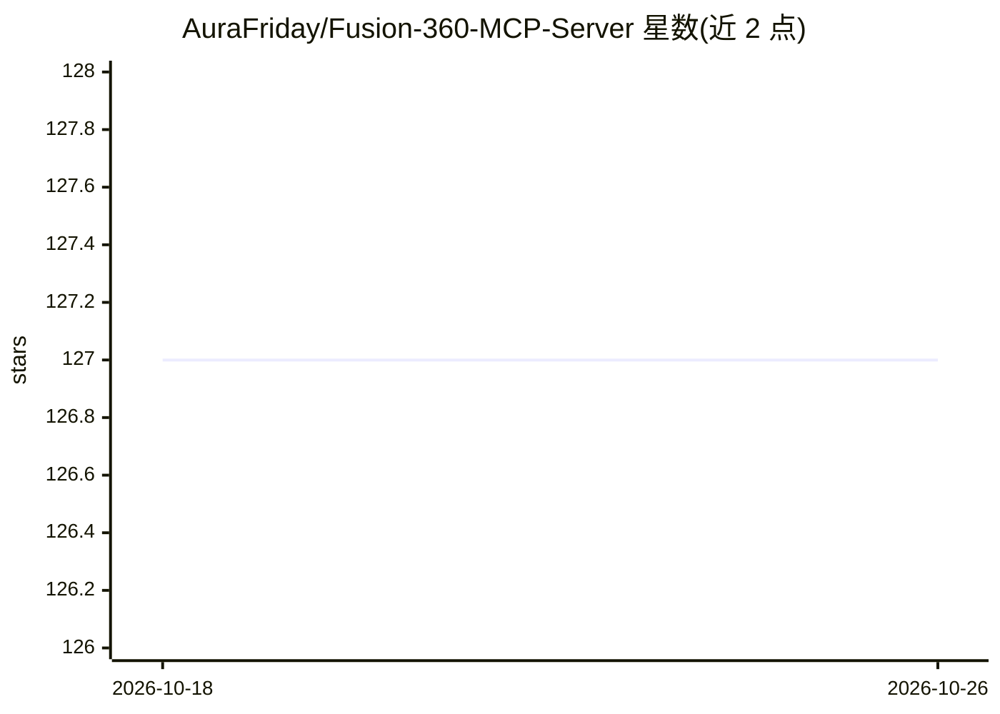

# AuraFriday/Fusion-360-MCP-Server

⭐ 127 · Python · NOASSERTION · 推送 2026-01-28 · [GitHub](https://github.com/AuraFriday/Fusion-360-MCP-Server) · [官网](https://aurafriday.com/) · 组织维护

**让 AI 通过 MCP 控制 Autodesk Fusion 的插件**

Autodesk Fusion 插件，通过连接 Aura Friday MCP-Link 服务器将 Fusion 注册为 fusion360 远程工具，供 AI agent 调用。提供三类能力：通用 API 调用（按路径执行任意 Fusion API）、在 Fusion 内运行任意 Python 代码（访问 adsk.core/fusion/cam、已加载插件、SQLite 等）、以及调用浏览器自动化、桌面控制、AI 模型等 10+ 内置 MCP 工具；另含三层 API 文档检索。API 调用经主线程队列执行。安装需先下载 MCP-Link Server，再从 Autodesk 官方商店或克隆仓库加载为插件。

## 筛选速览

| 维度 | 判定 | 备注 |
|---|---|---|
| AI 角色 | `ai-ecosystem` | LLM/agent 周边工具 |
| 许可风险 | `none` | NOASSERTION |
| 部署形态 | `None` |  |
| 模型依赖 | — | README 未给出锁定关系 |
| 硬件要求 | — | 无带数字的原话,不猜 |
| 安装摩擦 | `low` | 无编译、无系统依赖或容器化 |
| 成熟度 | — | 结构信号不足 |

## 能力要点

- 通用 API 处理器按路径动态执行任意 Fusion API 调用
- 在 Fusion 内执行任意 Python，可访问全部 API 与已加载插件
- 内置 10+ MCP 工具：SQLite、浏览器自动化、桌面控制、OpenRouter 500+ 模型、HuggingFace 离线模型等
- 三层文档检索：内省搜索、Autodesk 在线文档（含代码样例）、最佳实践指南

## 适用场景

- 用自然语言让 AI 在 Fusion 中创建参数化草图与机械零件
- AI 批量处理设计与数据库查询的工作流自动化
- 通过 AI 调用生成 CAM 刀路并优化切削参数
- 借助 AI 指引学习 Fusion API

## 场景标签

`GUI 自动化` · 领域:效率与自动化

## 证据(README 行号)

> L5: This add-in for Autodesk Fusion connects to the Aura Friday MCP-Link server, making Fusion available as a remote too
> L218: 1. **Add-in loads** and connects to local MCP-Link server
> L230: - **MCP-Link Server** - Routes AI requests to the add-in

## 星数曲线

2026-10-18 127 → 2026-10-26 127（+0）

---
*卡片 v1 · prompt 1.4 · 生成 2026-10-23 · 置信度 high · 依据 README sha `d6419eb87362` · [字段定义](../../DATASET.md)*
