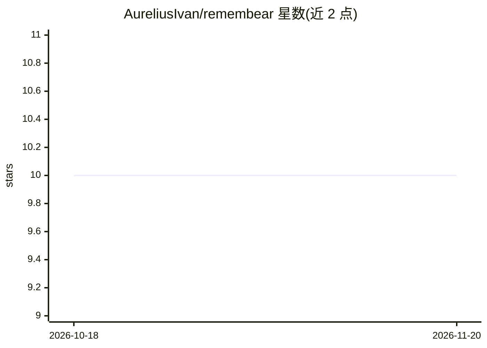

# AureliusIvan/remembear

⭐ 10 · TypeScript · 推送 2026-11-17 · [GitHub](https://github.com/AureliusIvan/remembear) · [官网](https://remembear.ivann.my.id/) · 个人维护

**面向短期记忆需求者的备忘应用，AI 辅助记忆管理**

Remembear 是一款帮助用户记录短期事项（购物清单、待办等）的应用，提供后端、前端与移动端三部分。架构上以 Gemini API 为默认 LLM 服务，通过 LiteLLM 集成 Mem0AI 的上下文记忆能力，Qdrant 作为默认向量数据库，FastAPI 后端、Next.js 前端，并经 Capacitor.js 打包为移动应用；支持 Docker Compose 部署，Vercel 托管前端，Firebase 提供推送通知。README 未给出 Demo（标注 Coming soon）。

## 筛选速览

| 维度 | 判定 | 备注 |
|---|---|---|
| AI 角色 | `ai-enhanced` | 去掉 AI 部分产品仍成立 |
| 许可风险 | `none` | — |
| 部署形态 | `self-host` | docker 或自建部署 |
| 模型依赖 | — | README 未给出锁定关系 |
| 硬件要求 | — | 无带数字的原话,不猜 |
| 安装摩擦 | `low` | 无编译、无系统依赖或容器化 |
| 成熟度 | — | 结构信号不足 |

## 能力要点

- Gemini API 作为默认 LLM 服务（默认 gemini-1.5-flash）
- Mem0AI 提供上下文记忆，Qdrant 为默认向量库
- 支持 Docker Compose 部署，Capacitor.js 打包移动端
- Firebase 云消息/推送通知

## 适用场景

- 记录购物清单、待办等短期事项
- 为阿尔茨海默/失忆人群提供记忆辅助工具
- 本地或容器化部署个人备忘服务

## 场景标签

`知识库管理` · 领域:知识与检索

## 证据(README 行号)

> L15: *Remembear* is an app that helps you to remember things in short term memory. It's a simple app that can be used in
> L70: - Gemini API
> L74: - Mem0AI

## 星数曲线

2026-10-18 10 → 2026-11-20 10（+0）

---
*卡片 v1 · prompt 1.4 · 生成 2026-11-20 · 置信度 mid · 依据 README sha `f399420342cb` · [字段定义](../../DATASET.md)*
