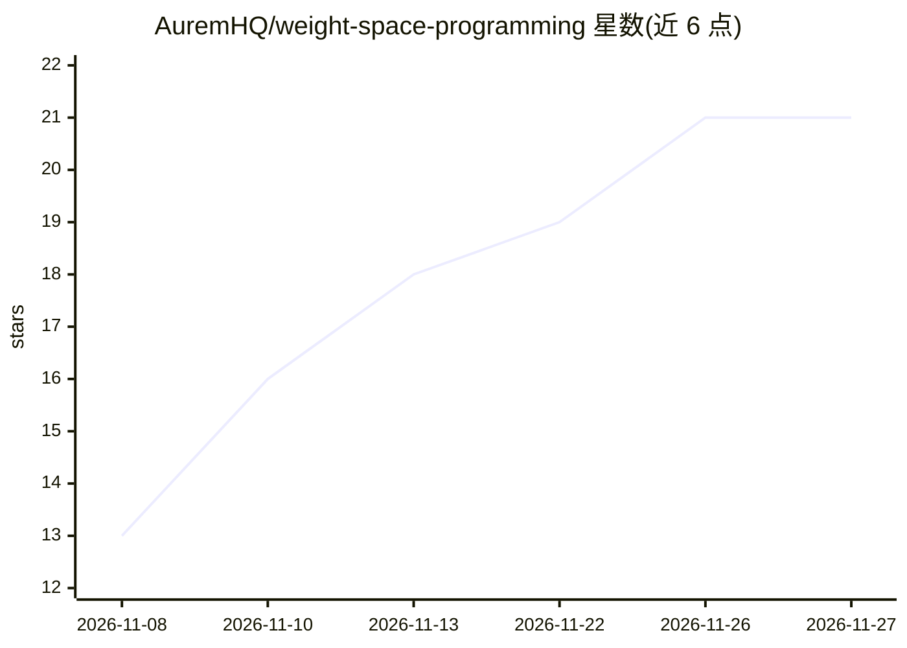

# AuremHQ/weight-space-programming

⭐ 21 · Python · MIT · 推送 2026-11-26 · [GitHub](https://github.com/AuremHQ/weight-space-programming) · [官网](https://auremhq.github.io/weight-space-programming/) · 组织维护

**小型开源权重模型的权重直编修复工具，含评估门禁**

面向拥有小型开放权重模型（Qwen/Gemma/Llama 级，≤3B）的开发者的工程工具：定位单一可复现的失败行为（如循环重复），诊断相关层与方向，直接对权重做减法或衰减编辑（上限 1% 权重），无重训练无梯度；随后用同提示同设置的评估门禁（主指标+5 且护栏指标不降超 2）决定是否放行，未通过则零权重交付。提供 CLI（wsp demo/run/loop/serve-model）与 MCP server，后者可将同一管线接入 agent。已发布 7 次真实模型运行，2 次通过门禁，均针对同一类列表循环失败；后台循环与热更新服务已可运行但无基准数据。

## 筛选速览

| 维度 | 判定 | 备注 |
|---|---|---|
| AI 角色 | `ai-ecosystem` | LLM/agent 周边工具 |
| 许可风险 | `permissive` | MIT |
| 部署形态 | `library` | 以包/库形式分发 |
| 模型依赖 | — | README 未给出锁定关系 |
| 硬件要求 | — | 无带数字的原话,不猜 |
| 安装摩擦 | `low` | 无编译、无系统依赖或容器化 |
| 成熟度 | `idea` | |

## 能力要点

- 直接编辑权重修复模型，无需重训练与梯度，编辑上限 1% 权重
- 评估门禁（+5/−2）决定是否交付，未通过即零权重放行
- 提供 CLI 与 MCP server，可被 agent/harness 调用
- wsp serve-model 支持在线应用通过门禁的修复并即时回滚

## 适用场景

- 我的小型本地模型有一个顽固的重复循环失败，想不重训练就修掉
- 对我的模型跑完整的门禁管线并得到 report.json 审查报告
- 让 agent 通过 MCP 调用权重修复管线

## 场景标签

`模型评测` · 领域:评测与运维

## 证据(README 行号)

> L16: > **wsp-kit by Aurem** — an engineering tool for small models. Try to fix small AI models by editing their weights 
> L114: - **kit/** — the runnable kit: engine, CLI, MCP server, task pack, and the universal real-model pipeline (`wsp run
> L135: For agents and harnesses, the same pipeline is an MCP server (requires `pip install 'wsp-kit[mcp]'` first):

## 星数曲线

2026-11-08 13 → 2026-11-27 21（+8）

---
*卡片 v1 · prompt 1.4 · 生成 2026-11-18 · 置信度 high · 依据 README sha `d4b7835819b5` · [字段定义](../../DATASET.md)*
