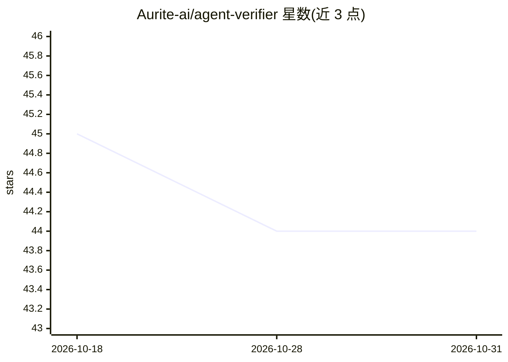

# Aurite-ai/agent-verifier

⭐ 44 · MIT · 推送 2026-10-13 · [GitHub](https://github.com/Aurite-ai/agent-verifier) · [官网](https://aurite.ai) · 组织维护

**面向编码 Agent 的代码验证技能：发码前检查安全、质量与 Agent 模式**

以 AI agent skill（SKILL 定义文件集）形式提供的自动审查工具：安装到 Claude Code、Cursor、Windsurf 等 30+ 编码助手中，通过 "verify agent" 触发，输出带严重度分级的结构化报告。检查覆盖硬编码密钥、输入校验等安全项，无限循环、无界重试、幻觉工具等 Agent 模式，Python/TypeScript/Go 语言规范，并自动检测 LangGraph、CrewAI、AutoGen、LangChain 等框架应用对应规则。默认独立模式零配置运行，可读取 ESLint/Biome 配置；装有 Kahuna 时加载组织规则库。检查分可靠性分级，非确定性解析器。

## 筛选速览

| 维度 | 判定 | 备注 |
|---|---|---|
| AI 角色 | `ai-ecosystem` | LLM/agent 周边工具 |
| 许可风险 | `permissive` | MIT |
| 部署形态 | `library` | 以包/库形式分发 |
| 模型依赖 | — | README 未给出锁定关系 |
| 硬件要求 | — | 无带数字的原话,不猜 |
| 安装摩擦 | `low` | 无编译、无系统依赖或容器化 |
| 成熟度 | — | 结构信号不足 |

## 能力要点

- 安全/Agent 模式/代码质量/语言专项四类检查，输出严重度分级报告
- 检测无限循环、无界重试、幻觉工具、上下文超限等 Agent 专属模式
- 自动检测 LangGraph/CrewAI/AutoGen/LangChain 并应用框架规则
- 通过 npx skills 安装到 30+ 编码助手，独立模式零配置

## 适用场景

- 在 Claude Code/Cursor 等助手中对代码做发布前安全与合规检查
- 审查 AI agent 项目中的循环、重试与工具注册问题
- 按组织规则（Kahuna 模式）执行团队编码规范

## 场景标签

`代码审查` · 领域:编码与开发

## 证据(README 行号)

> L19: Agent Verifier is an AI agent skill that acts as an automated reviewer. It checks for:
> L21: - 🔄 **Dangerous agent patterns** — infinite loops, unbounded retries, hallucinated tools
> L111: |`verification`|Full verification suite (orchestrator) — runs all checks below|

## 星数曲线

2026-10-18 45 → 2026-10-31 44（-1）

---
*卡片 v1 · prompt 1.4 · 生成 2026-10-25 · 置信度 high · 依据 README sha `5a99d7335e76` · [字段定义](../../DATASET.md)*
