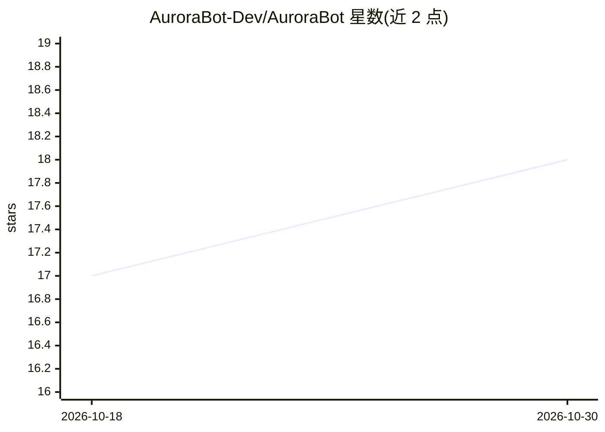

# AuroraBot-Dev/AuroraBot

⭐ 18 · Python · Apache-2.0 · 推送 2026-10-24 · [GitHub](https://github.com/AuroraBot-Dev/AuroraBot) · [官网](https://aurorabot-dev.github.io/AuroraBot/) · 组织维护 · 中文 README

**为自主 Agent 提供持续存在运行环境的 Bot 框架**

AuroraBot 是一个以 Bot 为主体设计的 Agent 运行框架：Bot 持有自己的世界、人格、目标与记忆，所有输入（用户消息、应用事件、MCP 上报、工具结果、时间流逝）都先作为世界事件进入她的环境，经模型理解判断后再决定回应、行动、委派或沉默；外部行动通过声明的 Tool 执行。基于 LiteLLM 接入模型 Provider，支持 MCP 工具协议，使用 SQLAlchemy/aiosqlite 做世界持久化。需要 Python 3.12 与 uv，通过仓库脚本安装后用 aurora start 启动，终端内直接对话，默认模型需配置 DEEPSEEK_API_KEY。面向希望构建持续存在、自主决策 Bot 的开发者。

## 筛选速览

| 维度 | 判定 | 备注 |
|---|---|---|
| AI 角色 | `ai-ecosystem` | LLM/agent 周边工具 |
| 许可风险 | `permissive` | Apache-2.0 |
| 部署形态 | `None` |  |
| 模型依赖 | — | README 未给出锁定关系 |
| 硬件要求 | — | 无带数字的原话,不猜 |
| 安装摩擦 | `low` | 无编译、无系统依赖或容器化 |
| 成熟度 | — | 结构信号不足 |

## 能力要点

- 以 Bot 为中心的架构：一切输入先成为世界事件再由模型理解判断
- Bot 持有自己的世界、人格、目标与记忆，认知运行只是其一段经历
- 基于 LiteLLM 的模型 Provider 接入与 MCP 客户端/工具协议支持
- 跨平台安装脚本（Linux/macOS/Windows）与终端对话界面

## 适用场景

- 构建一个能持续存在、有自主节律的对话 Bot
- 让 Bot 通过 MCP 与工具在外部环境中行动并积累经历
- 以世界事件模型统一管理用户消息与应用事件驱动的 Agent

## 场景标签

`Agent 框架` · 领域:Agent 开发

## 证据(README 行号)

> L17: AuroraBot 是一个为 Agent 提供可以"生活"的运行环境的 Bot 框架。我们想做的不是一个工具一般的 Agent，而是一个能够持续存在、形成自己的节律，并在环境中自主判断和行动的 Bot。
> L27: - **她拥有世界，运行只是她的经历**：Bot 持有自己的世界、目标与记忆。一次认知运行只是她的一段经历；聊天、任务、委派都是她生活中的一次经历，经历结束，她仍然存在。
> L29: - **她理解之后才决定**：来自用户的消息不会因为来源就自动成为最高指令。她先理解发生了什么，再决定回应、行动、委派或保持安静；模型只负责理解与判断，外部行动必须经声明的 Tool 执行，结果再作为新事件回到她的世界。

## 星数曲线

2026-10-18 17 → 2026-10-30 18（+1）

---
*卡片 v1 · prompt 1.4 · 生成 2026-10-30 · 置信度 high · 依据 README sha `1a30ab164b05` · [字段定义](../../DATASET.md)*
