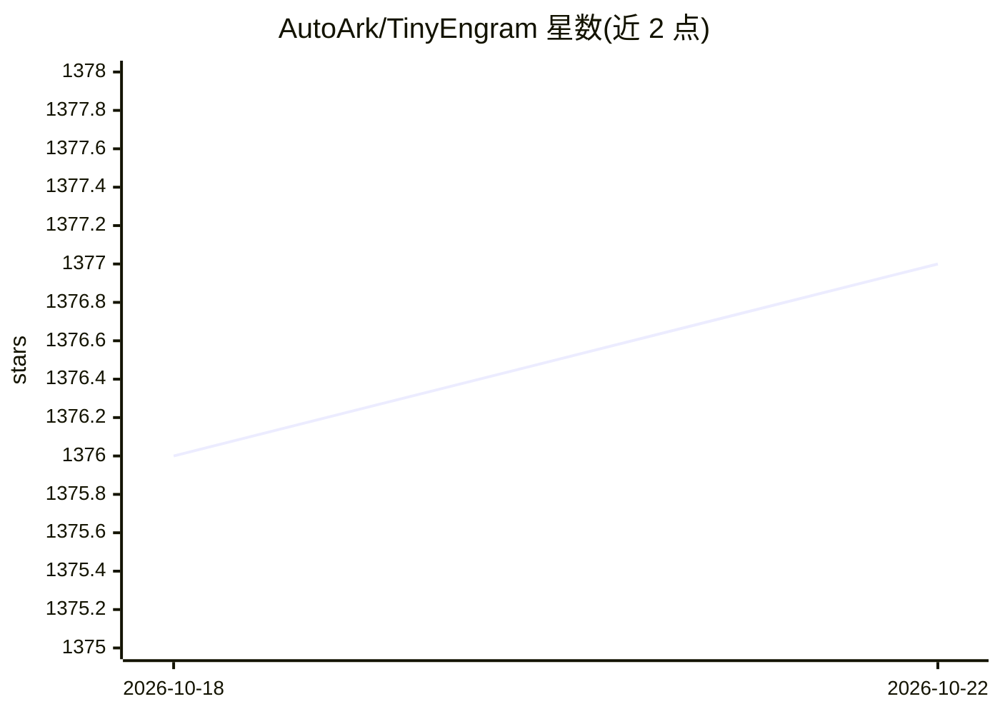

# AutoArk/TinyEngram

⭐ 1,377 · Python · 推送 2026-05-21 · [GitHub](https://github.com/AutoArk/TinyEngram) · 组织维护

**在 Qwen 与 Stable Diffusion 上复现/扩展 Engram 记忆注入的研究代码库**

围绕 DeepSeek-AI 的 Engram 架构的开放研究项目：将 N-gram 记忆模块与门控检索机制插入 Qwen 的解码器层做参数高效微调，并在 Stable Diffusion 文本编码器中注入视觉概念。实验报告 Engram 相对 LoRA 在参数效率与灾难性遗忘抗性上的表现，含词表规模与超参消融。提供固定版本依赖文件、训练/推理脚本与复现指南，基于 conda + pip 环境（Python 3.10），附 arXiv 技术报告。

## 筛选速览

| 维度 | 判定 | 备注 |
|---|---|---|
| AI 角色 | `ai-native` | 本体是模型或模型工具 |
| 许可风险 | `none` | — |
| 部署形态 | `library` | 以包/库形式分发 |
| 模型依赖 | — | README 未给出锁定关系 |
| 硬件要求 | — | 无带数字的原话,不猜 |
| 安装摩擦 | `low` | 无编译、无系统依赖或容器化 |
| 成熟度 | — | 结构信号不足 |

## 能力要点

- 在 Qwen 解码器层插入 Engram 模块做参数高效微调，仅新增参数可训练
- Engram 记忆注入扩展到 Stable Diffusion，冻结主干即可注入可组合视觉概念
- 提供 Engram vs LoRA 灾难性遗忘对比与系统超参消融实验
- 开放训练脚本、预处理数据集与推理 demo（SD1.5 与 SD3.5）

## 适用场景

- 复现或扩展 Engram 式记忆注入实验
- 在不微调主干的前提下向文生图模型注入特定角色/风格概念
- 研究参数高效微调方法在灾难性遗忘上的表现

## 场景标签

`微调` `图像生成` · 领域:内容生成

## 证据(README 行号)

> L91: **TinyEngram** is an open research project exploring the Engram architecture—an LLM enhancement that boosts phrase-
> L93: Built on Qwen, **TinyEngram** provides a lightweight, ready-to-train codebase for anyone to reproduce, experiment w

## 星数曲线

2026-10-18 1,376 → 2026-10-22 1,377（+1）

---
*卡片 v1 · prompt 1.4 · 生成 2026-10-21 · 置信度 high · 依据 README sha `2f59aec741aa` · [字段定义](../../DATASET.md)*
