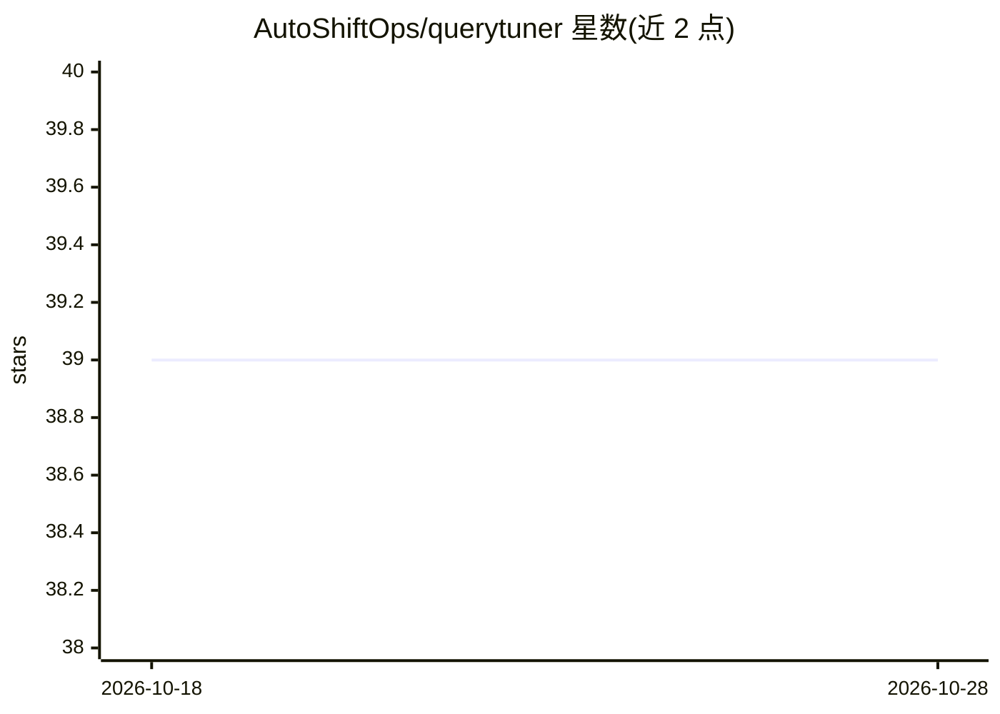

# AutoShiftOps/querytuner

⭐ 39 · Python · MIT · 推送 2026-10-25 · [GitHub](https://github.com/AutoShiftOps/querytuner) · [官网](https://querytuner.com) · 组织维护

**免连库的 SQL 查询诊断工具：粘贴即分析性能问题**

面向开发者的 SQL 查询诊断 Web 应用：用户粘贴查询文本（可选附 CREATE TABLE DDL），无需连接数据库即可获得分析。两层机制：12 条确定性规则组成的启发式引擎（默认启用、不需 API key），加上可选 AI 层（HuggingFace Qwen2.5-Coder 默认免费，或 OpenAI gpt-4o-mini）生成 CTE 改写、CREATE INDEX 建议与自然语言诊断。支持 PostgreSQL/MySQL/Oracle/SQL Server/SQLite 五种方言，提供 REST API、可分享报告 URL、客户端查询脱敏器。已知限制：无实时数据库连接、分析无状态、依赖 HuggingFace 免费额度可用性。

## 筛选速览

| 维度 | 判定 | 备注 |
|---|---|---|
| AI 角色 | `ai-enhanced` | 去掉 AI 部分产品仍成立 |
| 许可风险 | `permissive` | MIT |
| 部署形态 | `None` |  |
| 模型依赖 | — | README 未给出锁定关系 |
| 硬件要求 | — | 无带数字的原话,不猜 |
| 安装摩擦 | `low` | 无编译、无系统依赖或容器化 |
| 成熟度 | — | 结构信号不足 |

## 能力要点

- 12 条确定性启发式规则，无需 API key 或数据库连接
- 可选 AI 层：HuggingFace Qwen2.5-Coder（默认免费）或 OpenAI，结构化 JSON 输出
- 5 种数据库方言并生成各自语法正确的索引 DDL
- 客户端查询脱敏器：真实表名/列名不离开浏览器

## 适用场景

- 开发者粘贴慢 SQL 快速获得索引与改写建议
- CI/CD 流水线中通过 REST API 自动检查 SQL
- 在不连接生产数据库的前提下审查查询性能与注入风险

## 场景标签

`代码审查` · 领域:编码与开发

## 证据(README 行号)

> L27: 1. **Heuristic Engine** (always on, instant) — rule-based detection of common performance
> L31: 2. **AI Layer** (optional) — powered by HuggingFace (`Qwen/Qwen2.5-Coder`) or OpenAI
> L38: - ⚡ **Heuristic Engine** — 12 deterministic rules, always available, no external API calls required

## 星数曲线

2026-10-18 39 → 2026-10-28 39（+0）

---
*卡片 v1 · prompt 1.4 · 生成 2026-10-25 · 置信度 high · 依据 README sha `64a974ebd7c4` · [字段定义](../../DATASET.md)*
