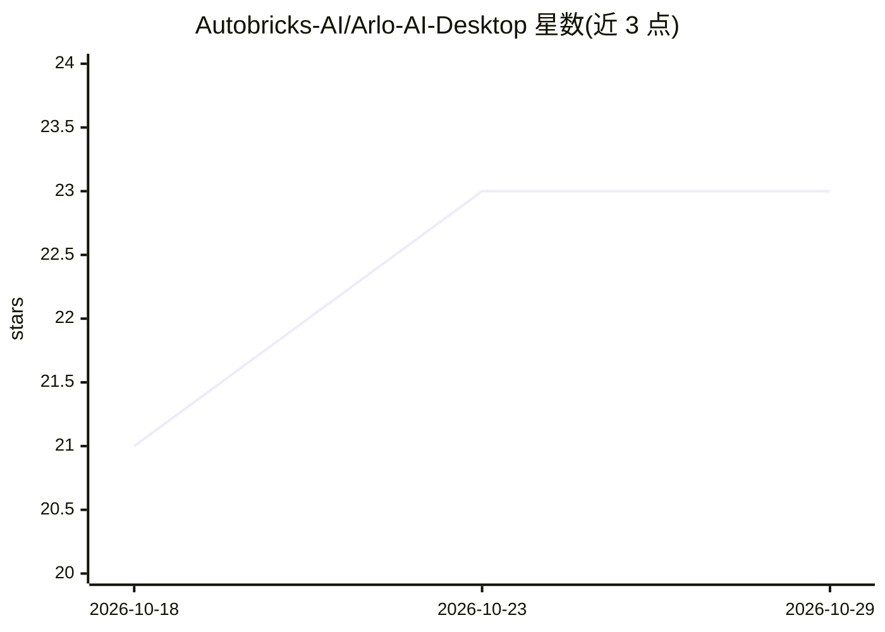

# Autobricks-AI/Arlo-AI-Desktop

⭐ 23 · TypeScript · NOASSERTION · 推送 2026-10-21 · [GitHub](https://github.com/Autobricks-AI/Arlo-AI-Desktop) · [官网](https://arlo.autobricks.ai) · 组织维护

**自托管的 AI 客服与销售问答系统，本地数据、带引用回答**

面向企业的自托管客服/销售应用：读取上传文档、抓取网站与手写笔记（含 OCR 扫描 PDF），通过网页挂件、Telegram、WhatsApp、Gmail/Outlook 等渠道回答客户，引用答案来源段落并在适当时转人工。所有数据存储在本地 Postgres 容器（含 pgvector），不上传文档。检索默认用 Postgres 全文搜索（无 API key 可用），配置 embeddings key 后启用向量语义搜索。模型仅支持 Autobricks 一家，接入需粘贴 Autobricks API key；更换提供商需修改源码中的端点常量。安装仅需 Docker：git clone 后运行 setup 脚本与 docker compose up -d。

## 筛选速览

| 维度 | 判定 | 备注 |
|---|---|---|
| AI 角色 | `ai-native` | 本体是模型或模型工具 |
| 许可风险 | `none` | NOASSERTION |
| 部署形态 | `self-host` | docker 或自建部署 |
| 模型依赖 | — | README 未给出锁定关系 |
| 硬件要求 | — | 无带数字的原话,不猜 |
| 安装摩擦 | `low` | 无编译、无系统依赖或容器化 |
| 成熟度 | — | 结构信号不足 |

## 能力要点

- 多渠道接入：网页挂件、Telegram、WhatsApp、Gmail/Outlook 统一收件箱
- 带引用回答、置信度下限、人工接管与草稿编辑（部分为 Cloud 版功能）
- 无 API key 也可运行：全文检索 + 转人工，而非编造答案
- 数据全部存于本地 Postgres 容器，文档文件存文件卷不进数据库
- 从已完成对话中学习并经人工批准后归档为知识条目

## 适用场景

- 中小企业在自己服务器上运行带引用的客服机器人
- 让客户通过 Telegram/WhatsApp/邮件获得基于公司文档的回答
- 在无任何 API key 时先用全文检索 + 人工接管模式上线

## 场景标签

`聊天机器人` `文档问答` · 领域:对话与助手

## 证据(README 行号)

> L3: Customer service and sales, answered from what your company already knows, on your own
> L6: Point Arlo at your documents and your website. It answers customers on whatever channel
> L33: |Cited answers, confidence floor, hand-off to a person|✓|✓|

## 星数曲线

2026-10-18 21 → 2026-10-29 23（+2）

---
*卡片 v1 · prompt 1.4 · 生成 2026-10-27 · 置信度 mid · 依据 README sha `51bea94b6ab4` · [字段定义](../../DATASET.md)*
