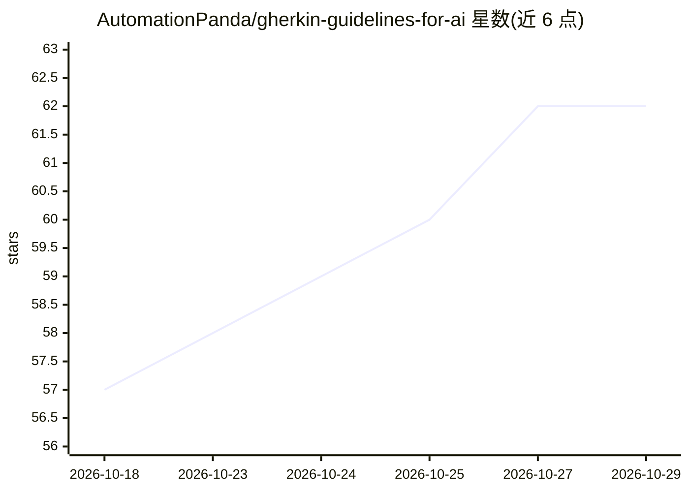

# AutomationPanda/gherkin-guidelines-for-ai

⭐ 62 · MIT · 推送 2026-04-30 · [GitHub](https://github.com/AutomationPanda/gherkin-guidelines-for-ai) · 个人维护

**供 AI 编码代理使用的 Gherkin 场景编写规范文档**

一个 Markdown 格式的 Gherkin 场景编写规范文件（gherkin-guidelines.md），供人工阅读学习或作为上下文喂给 AI specs、agents 与 skills，用于生成验收标准与测试用例场景。文档内嵌若干风格选择（Cucumber 兼容语法、kebab-case 文件名、2 空格缩进等）并逐条列出可选替代方案，用户可编辑文件调整。集成方式包括粘贴到对话、作为项目上下文引用、配置为规则或技能等。安装方式为直接复制文件到项目。

## 筛选速览

| 维度 | 判定 | 备注 |
|---|---|---|
| AI 角色 | `ai-knowledge` | 知识聚合/清单类 |
| 许可风险 | `permissive` | MIT |
| 部署形态 | `None` |  |
| 模型依赖 | — | README 未给出锁定关系 |
| 硬件要求 | — | 无带数字的原话,不猜 |
| 安装摩擦 | `low` | 无编译、无系统依赖或容器化 |
| 成熟度 | — | 结构信号不足 |

## 能力要点

- 提供 Gherkin 场景编写规范的单文件上下文文档
- 以表格列出内嵌风格选择及其替代方案，可自行编辑
- 给出 5 种 AI 代理集成方式（粘贴/引用/规则/技能/上下文工程）
- 语法与 Cucumber 兼容

## 适用场景

- 让 AI 编码代理按规范生成 Gherkin 场景与验收标准
- BDD 测试自动化中生成或修改场景并辅助代码评审
- 在编写用户故事时生成 Gherkin 格式的验收标准
- 规约驱动开发：从审批后的 feature spec 生成产品与测试代码

## 场景标签

`教程课程` · 领域:学习与行业

## 证据(README 行号)

> L3: `gherkin-guidelines.md`
> L6: Feed it as context to AI specs, agents, and skills to generate scenarios for acceptance criteria and test cases.

## 星数曲线

2026-10-18 57 → 2026-10-29 62（+5）

---
*卡片 v1 · prompt 1.4 · 生成 2026-10-24 · 置信度 high · 依据 README sha `d37705f35fe8` · [字段定义](../../DATASET.md)*
