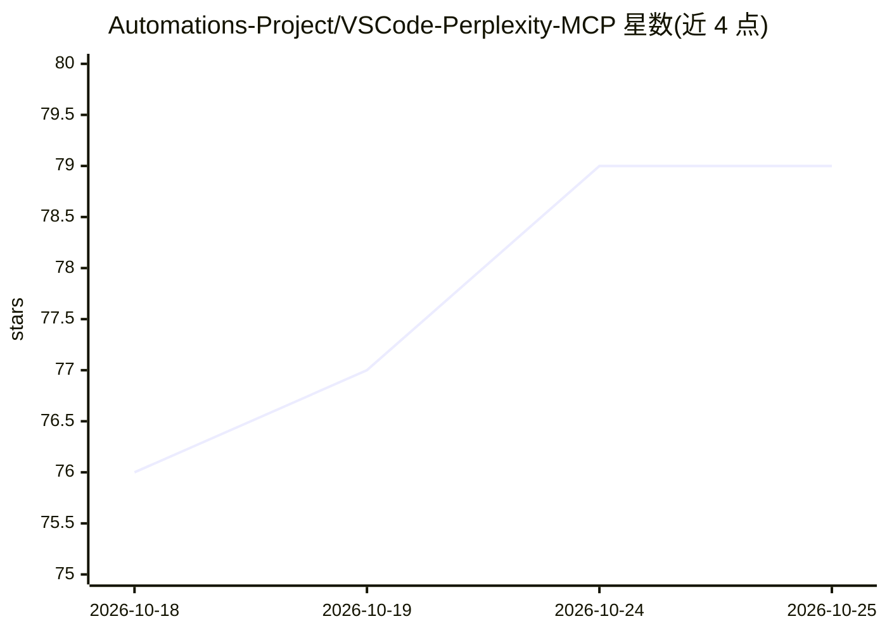

# Automations-Project/VSCode-Perplexity-MCP

⭐ 79 · TypeScript · MIT · 推送 2026-07-17 · [GitHub](https://github.com/Automations-Project/VSCode-Perplexity-MCP) · [官网](https://www.npmjs.com/package/perplexity-user-mcp) · 组织维护

**把 Perplexity 账号封装为 MCP 工具的 VS Code 扩展与独立服务器**

Monorepo 形态提供两种交付：VS Code 原生扩展（内嵌 MCP 守护进程、webview 仪表盘、20+ IDE 自动配置）与可全局安装的 npm CLI。通过 patchright 驱动长驻 Chromium 会话登录用户已有 Perplexity 账号（Free/Pro/Max），暴露 search/ask/reason/research/compute 等 MCP 工具，无需 API key。请求走 Perplexity 私有 web 端点（SSE 流），README 声明该端点形态可能漂移，且项目标注为实验性、不建议生产使用。

## 筛选速览

| 维度 | 判定 | 备注 |
|---|---|---|
| AI 角色 | `ai-ecosystem` | LLM/agent 周边工具 |
| 许可风险 | `permissive` | MIT |
| 部署形态 | `library` | 以包/库形式分发 |
| 模型依赖 | — | README 未给出锁定关系 |
| 硬件要求 | — | 无带数字的原话,不猜 |
| 安装摩擦 | `low` | 无编译、无系统依赖或容器化 |
| 成熟度 | `idea` | |

## 能力要点

- 长驻 patchright 浏览器会话复用已登录的 Perplexity 账号，无需 API key
- 5 类工具：search/ask/reason/research/compute，支持 web/scholar/social 来源选择
- 20+ IDE 自动写入 MCP 配置与规则（VS Code/Cursor/Claude Desktop/Windsurf 等）
- Cookie 加密 vault（keytar + 口令回退）、多 profile 热切换守护进程

## 适用场景

- 在 VS Code 里以 MCP 工具形式使用自己 Perplexity 订阅的搜索与研究能力
- 为 Cursor、Claude Desktop、Codex CLI 等 MCP 客户端统一接入 Perplexity
- 通过守护进程 + 隧道在远程/无头环境长期运行 Perplexity MCP 服务

## 场景标签

`语义搜索` `科研工具` · 领域:知识与检索

## 证据(README 行号)

> L47: - **`perplexity-vscode`** – native VS Code extension with an embedded MCP daemon, webview dashboard, and auto‑confi
> L48: - **`perplexity-user-mcp`** – the same MCP server as a standalone npm package for Cursor, Claude Desktop, Claude Co
> L50: Both wrap a long‑lived **patchright** browser session against your existing Perplexity account, so the tools consum

## 星数曲线

2026-10-18 76 → 2026-10-25 79（+3）

---
*卡片 v1 · prompt 1.4 · 生成 2026-10-24 · 置信度 high · 依据 README sha `b872588e58e0` · [字段定义](../../DATASET.md)*
