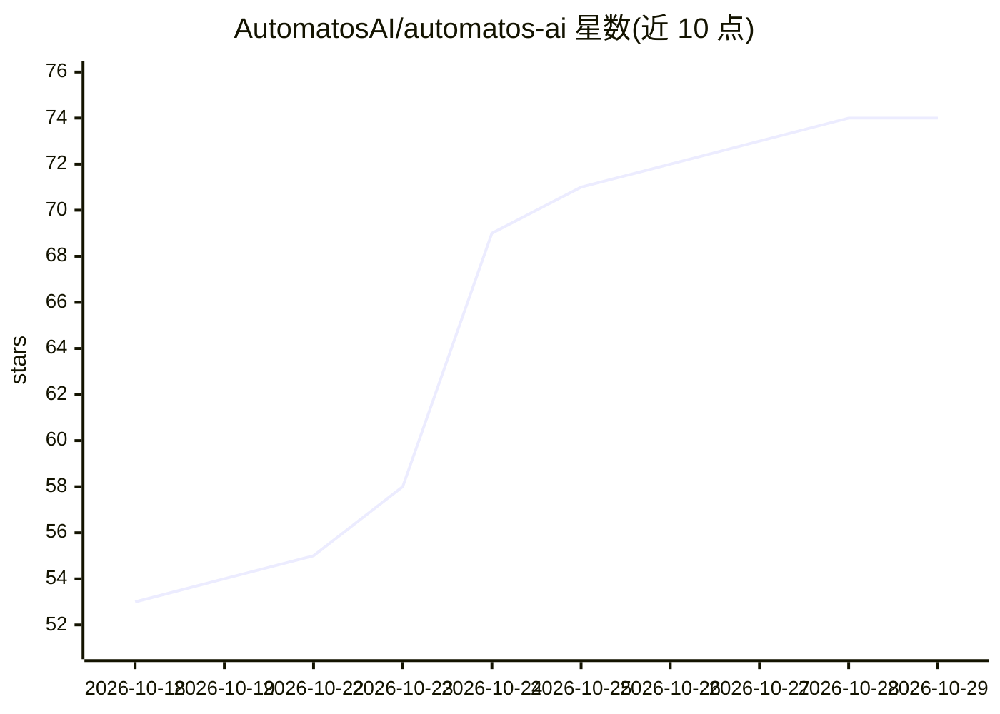

# AutomatosAI/automatos-ai

⭐ 74 · Python · Apache-2.0 · 推送 2026-10-28 · [GitHub](https://github.com/AutomatosAI/automatos-ai) · [官网](https://automatos.app) · 组织维护

**自托管多智能体编排系统：在本机运行 AI 工作者团队**

面向自托管用户的开源 AI 工作系统：通过统一对话入口 Auto 调度多个专职 agent，产出报告、代码、内容等 Deliverables。提供 Playbook 多步自动化、Mission 跨 agent 协调、Command Center 看板与日历、基于 pgvector 的 RAG 与知识图谱。模型接入通过统一路由注册表：OpenRouter、OpenAI/Anthropic/DeepSeek 等直连 key、NVIDIA 免费托管模型，或以自有 Claude Code 订阅作为 session agent 运行时（仅本地版）。工具集成经 Composio 提供 1000+ 连接。通过 git clone 加 make up（docker compose）本地部署，技术栈含 FastAPI/Nextjs。

## 筛选速览

| 维度 | 判定 | 备注 |
|---|---|---|
| AI 角色 | `ai-ecosystem` | LLM/agent 周边工具 |
| 许可风险 | `permissive` | Apache-2.0 |
| 部署形态 | `self-host` | docker 或自建部署 |
| 模型依赖 | locked-api |  |
| 硬件要求 | — | 无带数字的原话,不猜 |
| 安装摩擦 | `low` | 无编译、无系统依赖或容器化 |
| 成熟度 | `idea` | |

## 能力要点

- 统一路由注册表接入 400+ 模型（OpenRouter/直连 key/NVIDIA 免费托管）
- Session mode 将自有 Claude Code 订阅作为 agent 运行时（本地版）
- Composio 提供 1000+ 工具集成，语义排序按轮次筛选动作
- Command Center 看板/日历 + 逐调用成本记录与分析面板

## 适用场景

- 在自己服务器上运行多 agent 团队完成报告、代码、内容等工作
- 把已有的 Claude Code 订阅纳入统一的 agent 管理与工单流程
- 通过 Playbook/Mission 编排带调度的多步自动化任务

## 场景标签

`多智能体` · 领域:Agent 开发

## 证据(README 行号)

> L16: Automatos is an operating system for AI work. You command a workforce of specialised agents — equipped with skills,
> L29: |A shell|**Auto** — one chat that routes your request to the right agent, tool or Playbook|
> L34: |Drivers|**1,000+ tool integrations** through Composio and **400+ models** through one provider registry|

## 星数曲线

2026-10-18 53 → 2026-10-29 74（+21）

---
*卡片 v1 · prompt 1.4 · 生成 2026-10-24 · 置信度 high · 依据 README sha `e142a4f9a4f3` · [字段定义](../../DATASET.md)*
