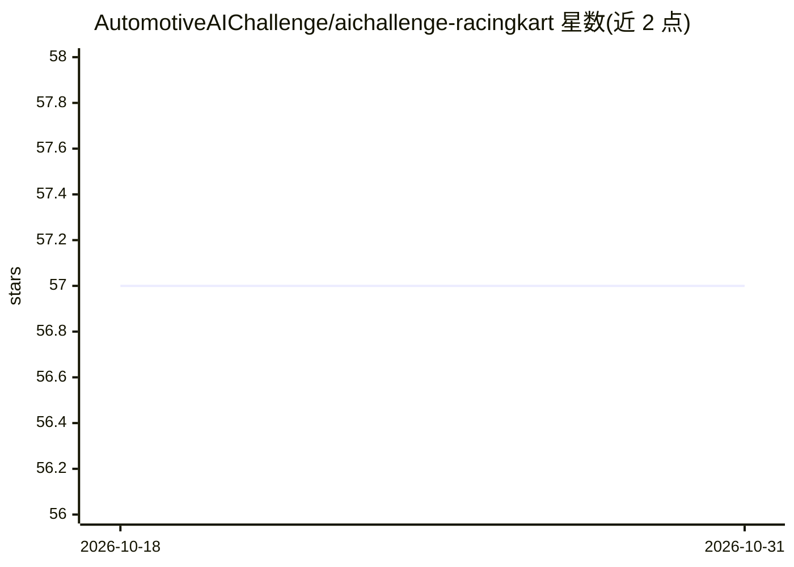

# AutomotiveAIChallenge/aichallenge-racingkart

⭐ 57 · Python · Apache-2.0 · 推送 2026-10-18 · [GitHub](https://github.com/AutomotiveAIChallenge/aichallenge-racingkart) · [官网](https://aichallenge-board.jsae.or.jp/) · 组织维护

**日本自动驾驶 AI 挑战赛（卡丁车）开发环境与脚本集**

为 Japan Autonomous Driving AI Challenge For RacingKart 提供开发环境：参赛者基于 Autoware Universe 开发自动驾驶软件，在 AWSIM 端到端仿真空间中集成到赛车卡丁车进行预选计时赛，决赛集成到真实卡丁车。仓库含仿真器/Autoware/评测启动脚本、实车环境（Zenoh/rosbag）、远距离连接辅助与文档。通过 Docker Compose 运行，setup.bash 自动检测 GPU 并生成 .env，Makefile 驱动构建/评测/仿真。

## 筛选速览

| 维度 | 判定 | 备注 |
|---|---|---|
| AI 角色 | `ai-ecosystem` | LLM/agent 周边工具 |
| 许可风险 | `permissive` | Apache-2.0 |
| 部署形态 | `self-host` | docker 或自建部署 |
| 模型依赖 | — | README 未给出锁定关系 |
| 硬件要求 | — | 无带数字的原话,不猜 |
| 安装摩擦 | `low` | 无编译、无系统依赖或容器化 |
| 成熟度 | — | 结构信号不足 |

## 能力要点

- 基于 Autoware Universe 的自动驾驶软件开发环境
- Docker Compose + Makefile 驱动仿真/评测/构建流程
- setup.bash 自动检测 GPU 生成配置并下载 AWSIM
- 含实车与远程连接辅助脚本（Zenoh/RViz/joy）

## 适用场景

- 参加自动驾驶 AI 挑战赛搭建开发与仿真环境
- 本地运行 Autoware 仿真与计时评测流程
- 实车卡丁车集成前的环境准备与验证

## 场景标签

 · 领域:自动驾驶/机器人

## 证据(README 行号)

> L3: 本リポジトリでは、自動運転AIチャレンジでご利用いただく開発環境を提供します。参加者の皆様には、Autoware Universe をベースとした自動運転ソフトウェアを開発し、予選大会では End to End シミュレーション空間
> L5: This repository provides a development environment use in the Automotive AI Challenge. For the preliminaries, partic

## 星数曲线

2026-10-18 57 → 2026-10-31 57（+0）

---
*卡片 v1 · prompt 1.4 · 生成 2026-10-24 · 置信度 high · 依据 README sha `93dbcbef48f9` · [字段定义](../../DATASET.md)*
