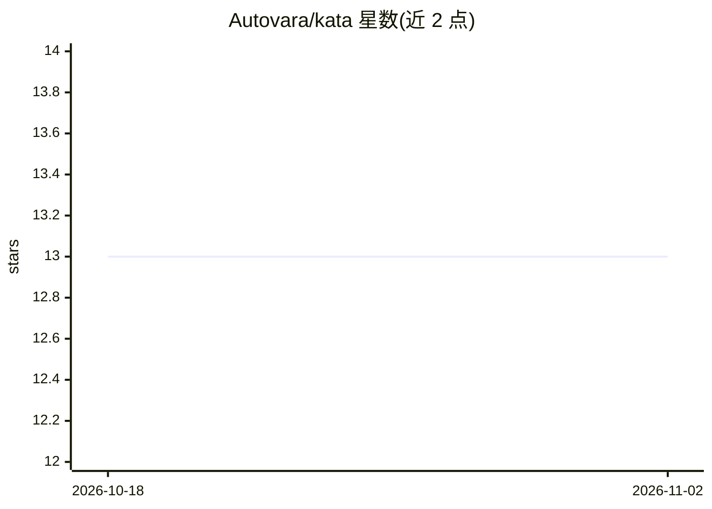

# Autovara/kata

⭐ 13 · Python · MIT · 推送 2026-07-30 · [GitHub](https://github.com/Autovara/kata) · [官网](https://dashboardking.ngrok.app/) · 组织维护

**通过公开 PR 竞赛为 Bittensor 子网选拔最优 AI agent 的竞赛引擎**

面向 Bittensor 子网贡献者的持续'王者守擂'竞赛引擎：贡献者通过 pull request 提交 agent，kata-bot 自动筛选后在相同秘密抽样的基准任务上挑战现任最优 agent（king），严格胜出者被合并加冕。核心引擎与具体子网解耦，通过 `kata.subnets` entry-point 插件接口接入各子网的任务、基准与评分；当前目标为 SN60 Bitsec 与 SN22 Desearch。基于 Gittensor（SN74）发放链上奖励，要求 Python 3.12+，用 uv CLI 脚手架生成提交目录并离线校验。

## 筛选速览

| 维度 | 判定 | 备注 |
|---|---|---|
| AI 角色 | `ai-ecosystem` | LLM/agent 周边工具 |
| 许可风险 | `permissive` | MIT |
| 部署形态 | `None` |  |
| 模型依赖 | — | README 未给出锁定关系 |
| 硬件要求 | — | 无带数字的原话,不猜 |
| 安装摩擦 | `low` | 无编译、无系统依赖或容器化 |
| 成熟度 | — | 结构信号不足 |

## 能力要点

- PR 提交 + 基准对决的持续 king-of-the-hill 竞赛循环
- 子网无关核心 + per-subnet 插件（entry-point 组）架构
- 提交规则含密钥密封（ciphertext 提交、机密 VM 内解密）与离线 preflight 校验
- 配套 kata-bot 自动化、kata-tee-runner 密封执行、kata-board 看板

## 适用场景

- 为 Bittensor 子网编写 agent 并通过 PR 参与公开竞赛
- 以可复现的基准分数取代主观评审决定 agent 合并
- 作为子网运营方接入新的竞赛目标插件

## 场景标签

`模型评测` · 领域:评测与运维

## 证据(README 行号)

> L5:  An objective, pull-request-based competition engine for autonomous AI agents.
> L27: Mining a subnet well usually takes deep, subnet-specific expertise. Kata crowdsources it. Contributors compete to b
> L40: One engine drives every subnet. The core in this repo is subnet-neutral: it runs the competition, and a per-subnet 

## 星数曲线

2026-10-18 13 → 2026-11-02 13（+0）

---
*卡片 v1 · prompt 1.4 · 生成 2026-11-01 · 置信度 high · 依据 README sha `3cace7656f88` · [字段定义](../../DATASET.md)*
