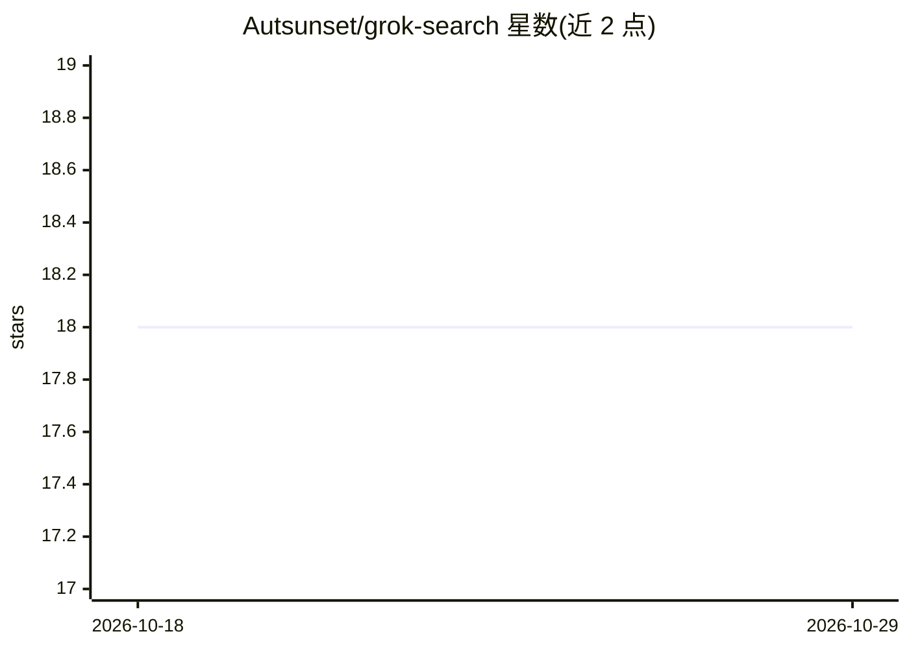

# Autsunset/grok-search

⭐ 18 · JavaScript · MIT · 推送 2026-07-13 · [GitHub](https://github.com/Autsunset/grok-search) · 个人维护 · 中文 README

**给 AI agent 用的网络访问技能包：搜索/抓取/站点地图**

轻量 Node.js 脚本包（search.js / fetch.js / map.js），为 AI agent 提供三类网络访问能力：Search 通过 Responses 或 Chat Completions 调用 Grok / OpenRouter / 兼容接口并并行返回 Tavily / Firecrawl 独立信源；Fetch 抓取 URL 可读内容并支持无 key 的 Direct Fetch 回退；Map 发现站点候选页面。支持 xai / openrouter / openai-compatible 三类 provider，代理、域名过滤、X handle 过滤等均可配置，配置写入 ~/.config/grok-search/config.json。附带给 agent 看的分步安装配置向导与失败排查表。需 Node>=18.17，search 功能必须提供 API key。

## 筛选速览

| 维度 | 判定 | 备注 |
|---|---|---|
| AI 角色 | `ai-ecosystem` | LLM/agent 周边工具 |
| 许可风险 | `permissive` | MIT |
| 部署形态 | `library` | 以包/库形式分发 |
| 模型依赖 | locked-api |  |
| 硬件要求 | — | 无带数字的原话,不猜 |
| 安装摩擦 | `low` | 无编译、无系统依赖或容器化 |
| 成熟度 | — | 结构信号不足 |

## 能力要点

- Search / Fetch / Map 三类脚本，覆盖搜索、抓取、站点发现
- 并行返回 Tavily / Firecrawl 独立信源并支持 Keyless 回退
- 支持 responses 与 chat 两种搜索协议及 xai / openrouter / openai-compatible 三类 provider
- 提供面向 agent 的交互式安装向导与按错误码的排查分支

## 适用场景

- 给 Claude 类或 pi 等 agent harness 挂载网页搜索/抓取技能
- 在回答中并行核对多个独立搜索信源
- 通过中转网关用 Grok 模型做联网搜索

## 场景标签

`网页抓取` · 领域:效率与自动化

## 证据(README 行号)

> L5: `grok-search` 是一个通用 AI agent skill / 脚本包，用轻量 Node.js 脚本提供三类网络访问能力：
> L204: 其他 agent harness 也可以采用同样方式：读取 `SKILL.md`，再按需运行 `scripts/search.js`、`scripts/fetch.js`、`scripts/map.js`。

## 星数曲线

2026-10-18 18 → 2026-10-29 18（+0）

---
*卡片 v1 · prompt 1.4 · 生成 2026-10-29 · 置信度 high · 依据 README sha `525c2c7ba572` · [字段定义](../../DATASET.md)*
