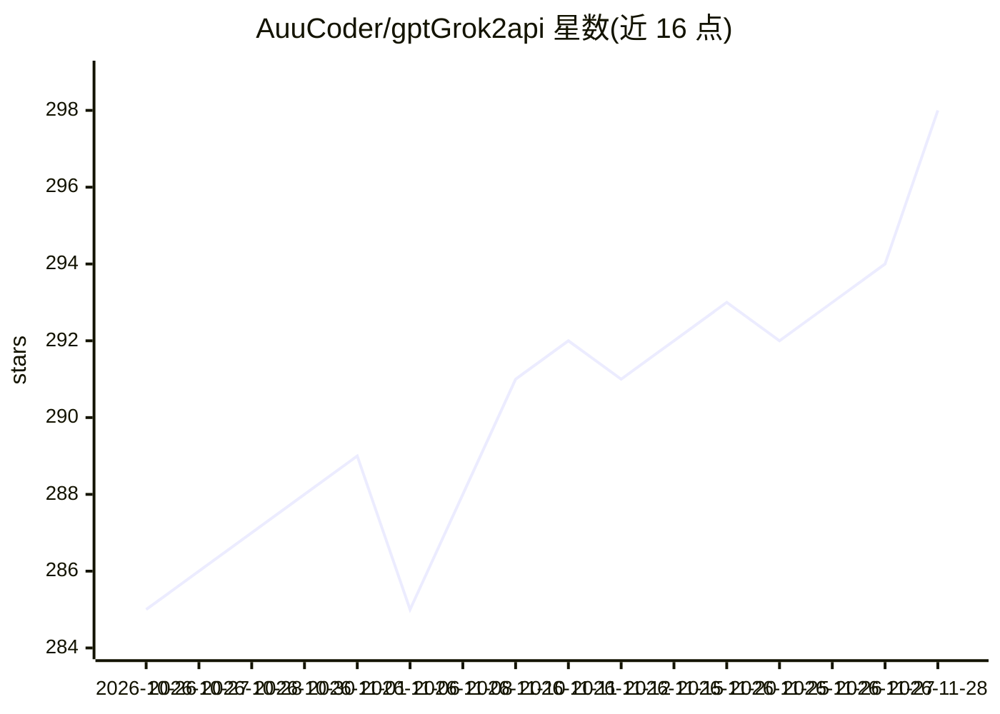

# AuuCoder/gptGrok2api

⭐ 298 · Python · MIT · 推送 2026-11-27 · [GitHub](https://github.com/AuuCoder/gptGrok2api) · [官网](https://muyuai.top) · 个人维护 · 中文 README

**自托管 GPT/Grok 账号注册与统一 API 网关**

自托管网关：将已接入的 GPT 与 Grok 订阅账号转换为 OpenAI 兼容 API，根 /v1 按模型自动分流，提供 Chat Completions、Responses、Images、Anthropic Messages 兼容入口，支持流式、工具调用与图片/视频生成。内置全自动注册中心（OAuth、邮箱接码、iCloud Privacy Mail、Turnstile 本地打码）、账号池与生命周期管理、代理轮换（WARP/Privoxy/FlareSolverr）及管理控制台。部署以 Docker Compose 为主，存储支持 JSON/SQLite/PostgreSQL/Git。

## 筛选速览

| 维度 | 判定 | 备注 |
|---|---|---|
| AI 角色 | `ai-ecosystem` | LLM/agent 周边工具 |
| 许可风险 | `permissive` | MIT |
| 部署形态 | `self-host` | docker 或自建部署 |
| 模型依赖 | locked-api |  |
| 硬件要求 | — | 无带数字的原话,不猜 |
| 安装摩擦 | `low` | 无编译、无系统依赖或容器化 |
| 成熟度 | — | 结构信号不足 |

## 能力要点

- OpenAI/Anthropic 兼容 API，按模型自动分流
- 全自动协议注册：OAuth、邮箱接码、账号池
- 本地 Captcha Solver 处理 Grok Turnstile
- 代理轮换与账号后台探测/自动恢复

## 适用场景

- 把多个 GPT/Grok 订阅账号统一暴露为 OpenAI 兼容 API
- 批量注册并管理 GPT/Grok 账号池
- 为下游 Sub2API/NovaApi 等服务自动投递账号

## 场景标签

`模型网关` · 领域:Agent 开发

## 证据(README 行号)

> L3: GPTGrok2API 是一个自托管的 GPT 与 Grok 统一网关，将已接入的订阅账号能力转换为 OpenAI 兼容 API，并提供账号、代理、注册、日志、图片和运行状态管理控制台。
> L16: |统一 API 网关|合并 GPT、Grok SSO 与 Grok Build OAuth 模型目录；根 `/v1` 根据模型自动分流，同时保留 `/grok/v1` 完整 Grok 接口。|
> L17: |协议兼容|提供 Chat Completions、Responses、Images、Anthropic Messages 兼容入口，支持流式与非流式响应、工具调用、搜索和推理强度。|

## 星数曲线

2026-10-26 285 → 2026-11-28 298（+13）

---
*卡片 v1 · prompt 1.4 · 生成 2026-11-28 · 置信度 mid · 依据 README sha `760187504c13` · [字段定义](../../DATASET.md)*
