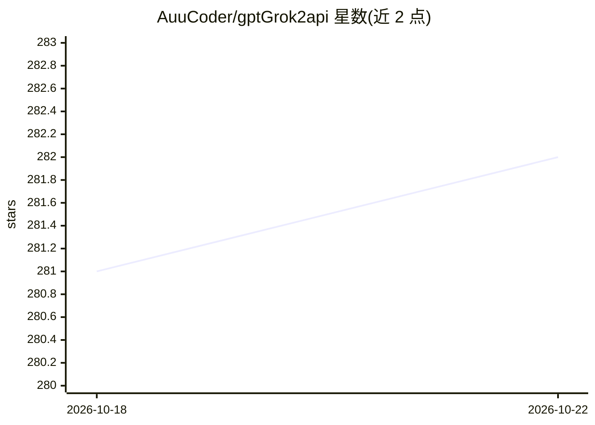

# AuuCoder/gptGrok2api

⭐ 282 · Python · MIT · 推送 2026-07-27 · [GitHub](https://github.com/AuuCoder/gptGrok2api) · [官网](https://muyuai.top) · 个人维护 · 中文 README

**自托管 GPT/Grok 统一网关，账号池与自动注册转 OpenAI 兼容 API**

GPTGrok2API 是自托管的 GPT 与 Grok 统一 API 网关：把已接入的订阅账号能力转换为 OpenAI 兼容接口（Chat Completions、Responses、Images、Anthropic Messages），并附管理控制台。功能覆盖 GPT/Grok 账号池管理与探测恢复、Grok OAuth 授权、OpenAI/Grok 自动注册（临时邮箱、Outlook Token、iCloud 隐私邮箱、内置 Turnstile 打码）、代理轮换与 WARP 出口。部署以 Docker Compose 为主，支持 macOS/Ubuntu systemd 与 Nginx HTTPS。

## 筛选速览

| 维度 | 判定 | 备注 |
|---|---|---|
| AI 角色 | `ai-ecosystem` | LLM/agent 周边工具 |
| 许可风险 | `permissive` | MIT |
| 部署形态 | `self-host` | docker 或自建部署 |
| 模型依赖 | — | README 未给出锁定关系 |
| 硬件要求 | — | 无带数字的原话,不猜 |
| 安装摩擦 | `low` | 无编译、无系统依赖或容器化 |
| 成熟度 | — | 结构信号不足 |

## 能力要点

- 统一 /v1 网关按模型自动分流 GPT 与 Grok，保留 /grok/v1 完整接口
- Grok 账号池、SSO/OAuth 探测与自动恢复（退避最长 24 小时）
- 内置 Turnstile 打码（Docker/Xvfb 有头浏览器）与 iCloud 隐私邮箱 sidecar
- 存储支持 JSON/SQLite/PostgreSQL/Git，图片支持本地与 WebDAV

## 适用场景

- 把 GPT/Grok 订阅账号聚合为 OpenAI 兼容 API 供下游应用调用
- 批量管理与恢复 Grok/GPT 账号池并监控额度与限流状态
- 自动注册 OpenAI/Grok 账号并投递到 NovaApi/CPA 等外部系统

## 场景标签

`模型网关` · 领域:Agent 开发

## 证据(README 行号)

> L3: GPTGrok2API 是一个自托管的 GPT 与 Grok 统一网关，将已接入的订阅账号能力转换为 OpenAI 兼容 API，并提供账号、代理、注册、日志、图片和运行状态管理控制台。
> L16: |统一 API 网关|合并 GPT、Grok SSO 与 Grok Build OAuth 模型目录；根 `/v1` 根据模型自动分流，同时保留 `/grok/v1` 完整 Grok 接口。|

## 星数曲线

2026-10-18 281 → 2026-10-22 282（+1）

---
*卡片 v1 · prompt 1.4 · 生成 2026-10-22 · 置信度 mid · 依据 README sha `b03256786004` · [字段定义](../../DATASET.md)*
