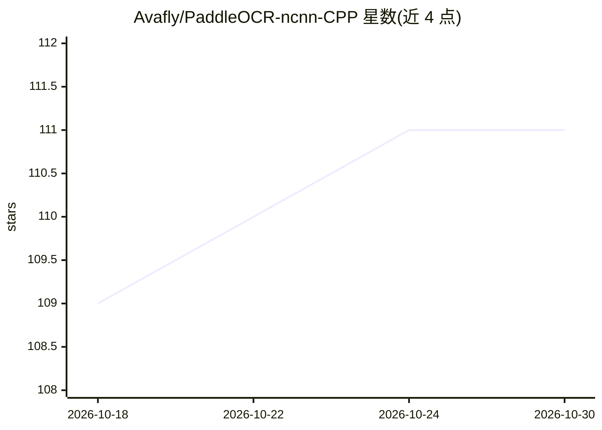

# Avafly/PaddleOCR-ncnn-CPP

⭐ 111 · C++ · MIT · 推送 2026-06-20 · [GitHub](https://github.com/Avafly/PaddleOCR-ncnn-CPP) · 个人维护

**C++ 实现的 PP-OCRv3-v6 OCR 推理，基于 ncnn**

以 ncnn 为推理框架、C++ 实现的 PP-OCRv3/4/5/6 文字识别（检测 DB + 识别 CRNN 相关结构），灵感来自 PaddleOCR 官方项目。Release 页提供含模型与示例图片的完整项目压缩包，解压后以命令行运行可执行文件处理图片。依赖 OpenCV 4.11.0、ncnn 20241226 与 OpenMP，已在 macOS 15、Debian 12、Windows 10/11 上测试；附 CPU 上的延迟与峰值内存基准数据，FP16 可经 config.json 开关但在部分设备可能产生 NaN。

## 筛选速览

| 维度 | 判定 | 备注 |
|---|---|---|
| AI 角色 | `ai-native` | 本体是模型或模型工具 |
| 许可风险 | `permissive` | MIT |
| 部署形态 | `desktop` | 安装包/桌面程序 |
| 模型依赖 | — | README 未给出锁定关系 |
| 硬件要求 | — | 无带数字的原话,不猜 |
| 安装摩擦 | `low` | 无编译、无系统依赖或容器化 |
| 成熟度 | — | 结构信号不足 |

## 能力要点

- PP-OCRv3/4/5/6 多版本模型的 C++ 推理实现
- 基于 ncnn 推理框架，Release 附模型与示例图
- 给出多模型 CPU 延迟与峰值内存基准
- FP16 可通过 config.json 启停

## 适用场景

- 在无 Python 环境的服务器或桌面运行 PP-OCR 推理
- 对比 PP-OCR 各版本模型的速度与内存占用
- 作为 ncnn 部署 OCR 的 C++ 参考实现

## 场景标签

`OCR` · 领域:感知与多模态

## 证据(README 行号)

> L1: This repository provides C++ implementations of PP-OCRv3/4/5/6, inspired by the official PaddleOCR project and using
> L10: ./main ../config.json ../images/ocr_img1.png

## 星数曲线

2026-10-18 109 → 2026-10-30 111（+2）

---
*卡片 v1 · prompt 1.4 · 生成 2026-10-23 · 置信度 high · 依据 README sha `b270850ff7cc` · [字段定义](../../DATASET.md)*
