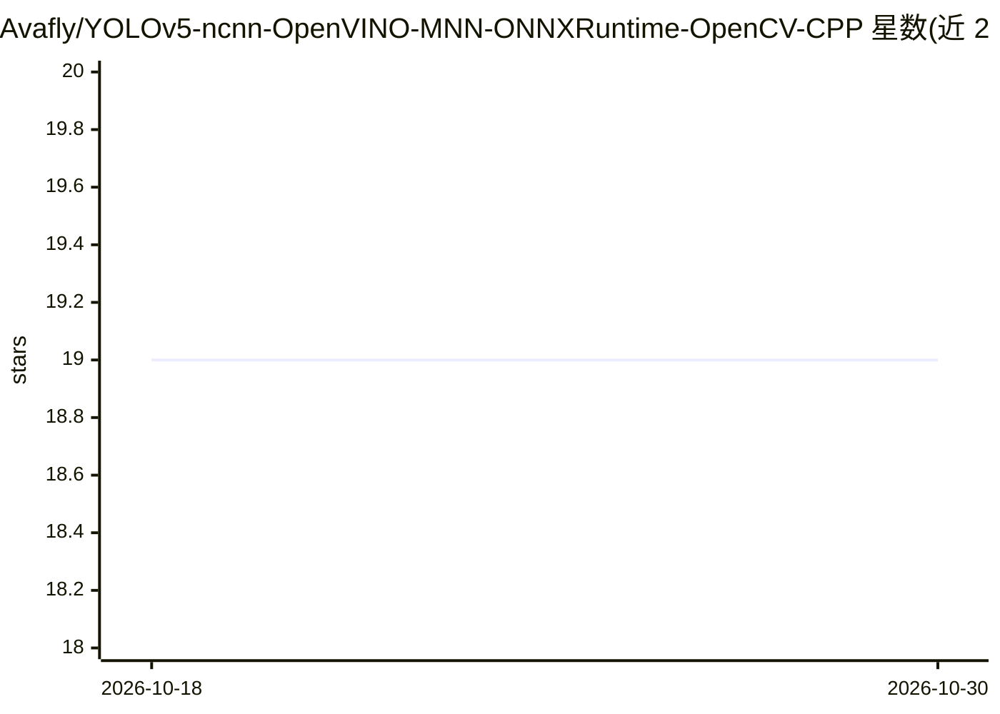

# Avafly/YOLOv5-ncnn-OpenVINO-MNN-ONNXRuntime-OpenCV-CPP

⭐ 19 · C++ · MIT · 推送 2026-01-28 · [GitHub](https://github.com/Avafly/YOLOv5-ncnn-OpenVINO-MNN-ONNXRuntime-OpenCV-CPP) · 个人维护

**多框架 YOLOv5 C++ 推理实现：支持动态输入尺寸**

用 C++ 分别基于 ncnn、OpenVINO、MNN、ONNXRuntime 与 OpenCV DNN 实现 YOLOv5 目标检测，推理拆分为初始化与检测两阶段；除 OpenCV 外各框架均支持动态输入尺寸，可改变输入分辨率以提升推理速度。项目同时可作为各推理框架的分步学习示例，作者用它评估各框架在设备上的可行性与资源占用，并给出 M1 MacBook Air 与 ARM Linux（仅 CPU）上的检测耗时基准。通过 CMake 从源码构建运行。

## 筛选速览

| 维度 | 判定 | 备注 |
|---|---|---|
| AI 角色 | `ai-native` | 本体是模型或模型工具 |
| 许可风险 | `permissive` | MIT |
| 部署形态 | `None` |  |
| 模型依赖 | — | README 未给出锁定关系 |
| 硬件要求 | — | 无带数字的原话,不猜 |
| 安装摩擦 | `medium` | 含编译或系统依赖之一 |
| 成熟度 | — | 结构信号不足 |

## 能力要点

- 五种推理框架的 YOLOv5 C++ 实现与对比基准
- 除 OpenCV 外支持动态输入尺寸
- 推理拆分为初始化与检测两阶段
- 提供 M1 与 ARM Linux CPU 耗时基准数据

## 适用场景

- 在 C++ 项目中跨框架运行 YOLOv5 检测图像或摄像头画面
- 对比各推理框架在目标设备上的耗时与资源占用
- 学习某一推理框架的分步接入方式

## 场景标签

`目标检测` `推理引擎` · 领域:感知与多模态

## 证据(README 行号)

> L3: This project implements YOLOv5 using multiple inference frameworks, including ncnn, OpenVINO, MNN, ONNXRuntime, and 
> L5: The code separates the inference into two parts: initialization and detection. You can view this project as an examp

## 星数曲线

2026-10-18 19 → 2026-10-30 19（+0）

---
*卡片 v1 · prompt 1.4 · 生成 2026-10-29 · 置信度 high · 依据 README sha `0a4467c9ff59` · [字段定义](../../DATASET.md)*
