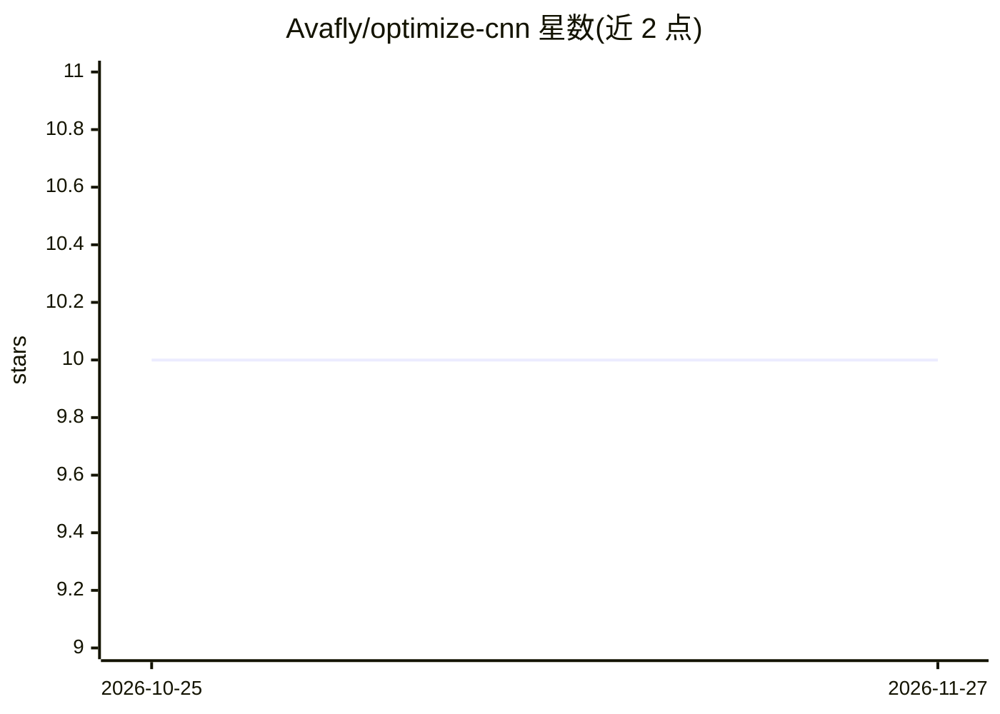

# Avafly/optimize-cnn

⭐ 10 · C++ · MIT · 推送 2026-08-29 · [GitHub](https://github.com/Avafly/optimize-cnn) · 个人维护

**面向开发者的手写小型 CNN 推理优化教程与基准（RPi 4B）**

针对 Fashion-MNIST 小型 CNN 的手写推理实现，目标硬件为树莓派 4B。从 im2col+GEMM 的朴素版本逐步演进：常量折叠架构、NEON 手写 GEMM 替代 OpenBLAS 并消除 im2col、卷积-池化-激活融合核，每版附耗时与逐层理论/实际开销分析。同时包含 ORT、ncnn、TFLite 三个框架的调优基线用于对比。训练与数据导出在 train.py，数据可从 releases 获取。适合已知硬件与固定模型架构的小模型部署场景。

## 筛选速览

| 维度 | 判定 | 备注 |
|---|---|---|
| AI 角色 | `ai-native` | 本体是模型或模型工具 |
| 许可风险 | `permissive` | MIT |
| 部署形态 | `None` |  |
| 模型依赖 | — | README 未给出锁定关系 |
| 硬件要求 | — | 无带数字的原话,不猜 |
| 安装摩擦 | `low` | 无编译、无系统依赖或容器化 |
| 成熟度 | — | 结构信号不足 |

## 能力要点

- 六档递进的手写 CNN 实现，最快版本 783 ms 推理 70,000 张图
- 基于 A72 NEON 理论 MAC 上限的逐层性能剖析方法
- 包含 ORT/ncnn/TFLite 三个调优后的框架基线对照
- 卷积+池化+激活融合为单一内核，中间结果不落内存

## 适用场景

- 嵌入式设备上部署小型固定架构 CNN 时参考优化路径
- 通过逐层理论/实测对比定位推理热点
- 评估通用推理框架在小模型上的性能表现

## 场景标签

`教程课程` · 领域:学习与行业

## 证据(README 行号)

> L5: This repo shows a tiny CNN implementation for recognizing fashion mnist. Simple, powerful enough, while extremely fa
> L30: |**cnn_neon**|**1045 ms**|

## 星数曲线

2026-10-25 10 → 2026-11-27 10（+0）

---
*卡片 v1 · prompt 1.4 · 生成 2026-11-20 · 置信度 high · 依据 README sha `f5b2dde0d0d7` · [字段定义](../../DATASET.md)*
