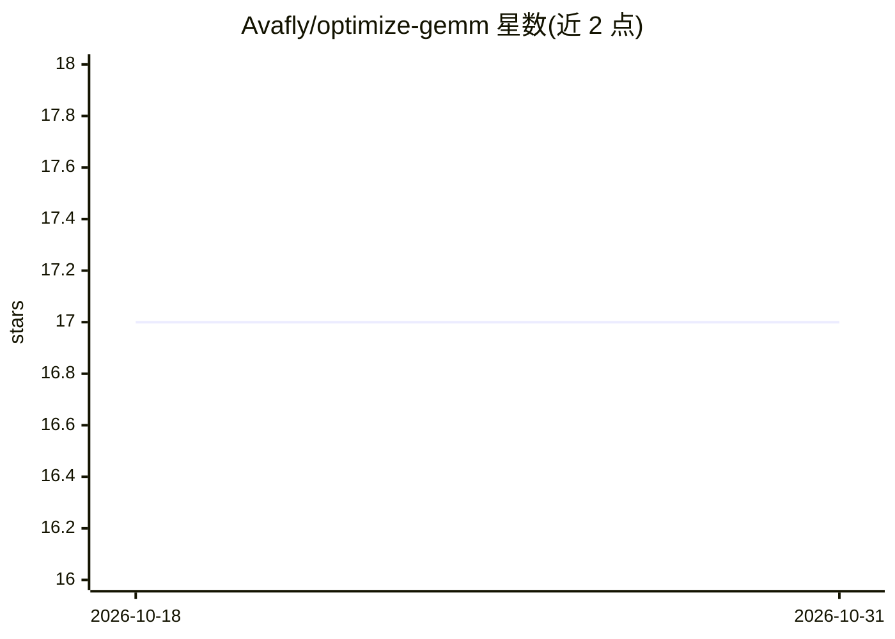

# Avafly/optimize-gemm

⭐ 17 · C++ · MIT · 推送 2026-08-07 · [GitHub](https://github.com/Avafly/optimize-gemm) · 个人维护

**树莓派4B上的CPU GEMM优化实践，达220倍加速**

个人高性能计算项目：在 Raspberry Pi 4 Model B（4GB RAM、Cortex-A72）上以纯CPU逐步优化矩阵乘法，经过 NEON SIMD 4x4/12x8 kernel、blocking/tiling、packing、并行计算与布局调度五步，从朴素实现的 0.1747 GFLOPS 提升到 38.5153 GFLOPS（220倍）。README 记录各步骤性能数据，并与 blis、openblas、eigen、gsl 做耗时与 GFLOPS 对比。代码为 C++ 源码文件，矩阵按行主序、从文本文件读取初始化以保证结果可复现，计算后打印求和与元素供正确性校验。

## 筛选速览

| 维度 | 判定 | 备注 |
|---|---|---|
| AI 角色 | `ai-ecosystem` | LLM/agent 周边工具 |
| 许可风险 | `permissive` | MIT |
| 部署形态 | `None` |  |
| 模型依赖 | — | README 未给出锁定关系 |
| 硬件要求 | `cpu-ok` | |
| 安装摩擦 | `low` | 无编译、无系统依赖或容器化 |
| 成熟度 | — | 结构信号不足 |

## 能力要点

- 五步优化路径：SIMD kernel → kernel尺寸选择 → blocking/packing → 布局与调度
- RPi 4B 纯CPU达到 38.5153 GFLOPS，相对朴素实现220倍加速
- 提供与 blis/openblas/eigen/gsl 的同机耗时对比表
- 矩阵从文本文件初始化，输出固定可复现并附正确性校验输出

## 适用场景

- 学习ARM NEON SIMD与cache友好的GEMM优化技术
- 参考树莓派等ARM平台上的矩阵乘法调优路径
- 对比自用线性代数内核与开源BLAS库的性能差距

## 场景标签

`教程课程` · 领域:学习与行业

## 证据(README 行号)

> L3: GEMM is crucial in AI inference, since it is the core of computations in many layers such as convolution and Transfo
> L41: Most linear algebra libraries provide gemm supports, and I tested against some well-known libraries: blis, openblas

## 星数曲线

2026-10-18 17 → 2026-10-31 17（+0）

---
*卡片 v1 · prompt 1.4 · 生成 2026-10-30 · 置信度 high · 依据 README sha `0a1ccfe0260c` · [字段定义](../../DATASET.md)*
