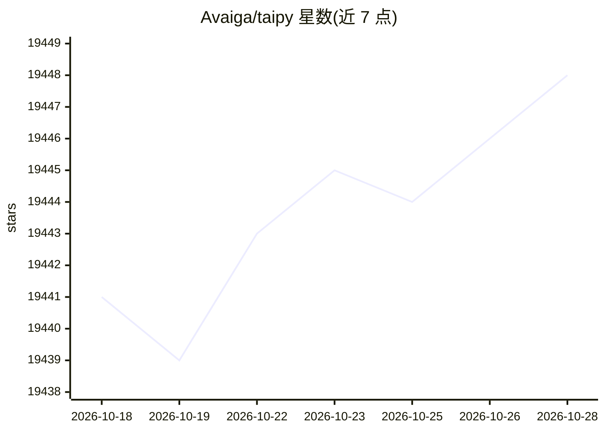

# Avaiga/taipy

⭐ 19,448 · Python · Apache-2.0 · 推送 2026-08-10 · [GitHub](https://github.com/Avaiga/taipy) · [官网](https://www.taipy.io) · 组织维护

**给数据科学家/ML工程师：把数据和AI算法快速变成Web应用**

Taipy 是 Avaiga 维护的 Python 库，面向数据科学家与机器学习工程师，用于构建数据与 AI 驱动的 Web 应用。功能覆盖用户界面生成、数据集成、流水线编排、假设分析与场景管理、认证与用户管理、定时任务调度。生态还包括 Taipy Designer、Taipy Studio、预定义模板与数据平台集成，并随附 CLI、部署脚本、版本管理、数据迁移和遥测监控等生产运维材料。仅需 Python（3.9–3.12），通过 pip 安装。

## 筛选速览

| 维度 | 判定 | 备注 |
|---|---|---|
| AI 角色 | `ai-ecosystem` | LLM/agent 周边工具 |
| 许可风险 | `permissive` | Apache-2.0 |
| 部署形态 | `library` | 以包/库形式分发 |
| 模型依赖 | — | README 未给出锁定关系 |
| 硬件要求 | — | 无带数字的原话,不猜 |
| 安装摩擦 | `low` | 无编译、无系统依赖或容器化 |
| 成熟度 | — | 结构信号不足 |

## 动量与使用信号

- 维护:`active` — 距上次 push 69.2 天,年发版 73,78 位贡献者
- 涨星:近 1 天 **+5**(自 20261016 起算)
- 安装:pypi 包 `taipy` 月下载 4,103

## 能力要点

- 以纯 Python 构建 Web 应用，无需学习其他语言
- 提供 UI 生成、数据集成、流水线编排与场景管理
- 内置认证、角色与用户管理、Cron 调度
- 附带 CLI、部署脚本、版本管理与遥测监控等运维工具

## 适用场景

- 把训练好的模型包装成生产可用的 Web 应用
- 为业务用户搭建假设分析和场景管理界面
- 对数据流水线做编排与定时调度
- 部署并维护数据/AI 应用的生产环境

## 场景标签

`MLOps` `工作流自动化` `数据分析` · 领域:效率与自动化

## 证据(README 行号)

> L56: Taipy is designed for data scientists and machine learning engineers to create
> L66: Taipy includes the Taipy Python library enabling developers to easily empower their end-users with:
> L120: Copyright 2021-2025 Avaiga Private Limited

## 星数曲线

2026-10-18 19,441 → 2026-10-28 19,448（+7）

---
*卡片 v1 · prompt 1.4 · 生成 2026-10-18 · 置信度 high · 依据 README sha `c80a080e7bbd` · [字段定义](../../DATASET.md)*
