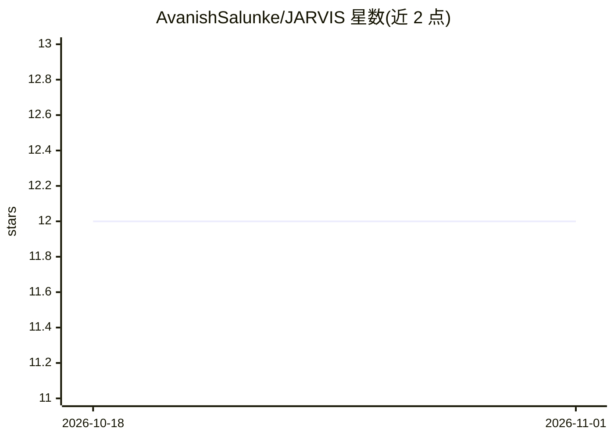

# AvanishSalunke/JARVIS

⭐ 12 · Python · 推送 2026-08-03 · [GitHub](https://github.com/AvanishSalunke/JARVIS) · [官网](https://jarvis-byte-me.vercel.app/) · 组织维护

**多模态 AI 桌面助手：语音/图像交互并本地操控系统**

JARVIS 是面向个人用户的多模态 AI 桌面助手，包含三个模块：AI Brain Layer（基于 LangChain，可接 Groq/OpenAI/Gemini/Mistral）负责理解与决策；Vision Module（Gemini Vision/GPT-4V）做图像描述、视觉问答与场景分析；Local Agent 在本地执行系统操作，如开关应用、调节音量/亮度/电源、网页自动化。后端 FastAPI + ChromaDB 记忆，前端 React。用户可通过网站下载 Windows 的 Jarvis_Agent.exe 并登录使用，或克隆源码本地运行，需配置 GROQ_API_KEY 与 SERPER_API_KEY。

## 筛选速览

| 维度 | 判定 | 备注 |
|---|---|---|
| AI 角色 | `ai-native` | 本体是模型或模型工具 |
| 许可风险 | `permissive` | — |
| 部署形态 | `desktop` | 安装包/桌面程序 |
| 模型依赖 | — | README 未给出锁定关系 |
| 硬件要求 | — | 无带数字的原话,不猜 |
| 安装摩擦 | `low` | 无编译、无系统依赖或容器化 |
| 成熟度 | — | 结构信号不足 |

## 能力要点

- 三模块架构：AI 决策层 + 视觉模块 + 本地执行代理
- 视觉问答、图像描述与场景分析（Gemini Vision/GPT-4V）
- 本地 OS 控制：应用管理、音量/亮度/电源调节、网页自动化
- ChromaDB 记忆存储与 Serper 联网搜索

## 适用场景

- 用对话让助手代为打开应用、调节系统设置
- 对图像提问并获得基于画面内容的回答
- 在本地 Windows 设备上执行低延迟自动化任务

## 场景标签

`多模态` `AI 助手` `GUI 自动化` · 领域:效率与自动化

## 证据(README 行号)

> L7: JARVIS is an AI-powered personal assistant designed to bridge the gap between intelligence and execution. Unlike con
> L9: At its core, JARVIS is a modular, locally-aware AI system that combines cloud-level reasoning with on-device control
> L22: |**AI / LLM**|LangChain Groq OpenAI Google Gemini Mistral|

## 星数曲线

2026-10-18 12 → 2026-11-01 12（+0）

---
*卡片 v1 · prompt 1.4 · 生成 2026-11-01 · 置信度 high · 依据 README sha `eb8fa3b90535` · [字段定义](../../DATASET.md)*
