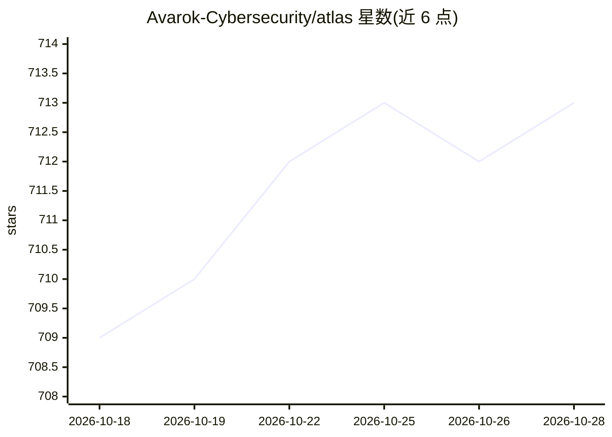

# Avarok-Cybersecurity/atlas

⭐ 711 · Rust · AGPL-3.0 · 推送 2026-10-26 · [GitHub](https://github.com/Avarok-Cybersecurity/atlas) · [官网](https://atlasinference.io) · 组织维护

**纯 Rust 编写的 LLM 推理引擎，面向 DGX Spark 等硬件**

由 Atlas Cybernetics 用 Rust 与 CUDA 编写的开源 LLM 推理引擎，以约 75 MB 单二进制提供 OpenAI/Anthropic/Responses 兼容服务端，无需 Python 或 PyTorch。特性含按硬件×模型×量化手调的 CUDA 内核、NVFP4/FP8 量化、推测解码（MTP 与 DFlash）、radix-tree 前缀缓存与跨节点专家并行。已在 NVIDIA DGX Spark（GB10）验证，同一 CUDA 源码经 SCALE 编译支持 AMD Strix Halo，Apple Silicon 处于早期 bring-up。安装提供 install.sh 脚本、cargo 与 Docker 镜像（Docker Hub avarok/atlas-gb10）。模型以 Qwen、Gemma、Mistral、MiniMax、Nemotron 等家族为主。

## 筛选速览

| 维度 | 判定 | 备注 |
|---|---|---|
| AI 角色 | `ai-ecosystem` | LLM/agent 周边工具 |
| 许可风险 | `dual` | AGPL-3.0 |
| 部署形态 | `self-host` | docker 或自建部署 |
| 模型依赖 | — | README 未给出锁定关系 |
| 硬件要求 | — | 无带数字的原话,不猜 |
| 安装摩擦 | `low` | 无编译、无系统依赖或容器化 |
| 成熟度 | `idea` | |

## 能力要点

- 单一 ~75 MB 二进制运行 OpenAI/Anthropic/Responses API，无 Python/PyTorch 依赖
- 按 (硬件×模型×量化) 手调 CUDA 内核，支持 NVFP4 与 FP8 量化
- 推测解码（MTP draft heads 与 DFlash block diffusion）与 radix-tree 前缀缓存
- 同一 CUDA 源码覆盖 NVIDIA GB10 与 AMD Strix Halo（经 SCALE），多节点 EP=2/EP=4 专家并行

## 适用场景

- 在 DGX Spark 等 120 GB 级硬件上本地部署 35B-122B 参数模型服务
- 为 opencode / Claude Code / Cline 等编码代理提供推理后端
- 用 OpenAI SDK 或 curl 直接接入自托管 LLM 服务

## 场景标签

`推理引擎` · 领域:训练与推理

## 证据(README 行号)

> L20: **Atlas** is an open-source **LLM inference engine** written in pure **Rust and CUDA**. It serves an **OpenAI-compa
> L118: Atlas speaks the OpenAI, Anthropic, and Responses APIs on the same port. `curl`, the OpenAI SDK, Open WebUI, openc

## 星数曲线

2026-10-18 709 → 2026-10-28 713（+4）

---
*卡片 v1 · prompt 1.4 · 生成 2026-10-21 · 置信度 high · 依据 README sha `3d2402a0adb6` · [字段定义](../../DATASET.md)*
