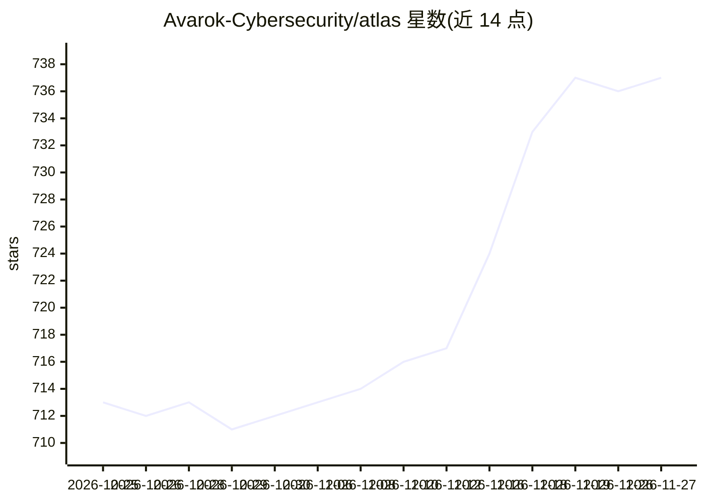

# Avarok-Cybersecurity/atlas

⭐ 737 · Rust · AGPL-3.0 · 推送 2026-11-23 · [GitHub](https://github.com/Avarok-Cybersecurity/atlas) · [官网](https://atlasinference.io) · 组织维护

**纯 Rust 编写的本地 LLM 推理引擎，提供 OpenAI 兼容服务**

Atlas 以纯 Rust 和 CUDA 实现 LLM 推理，从单个约 75 MB 二进制文件提供 OpenAI、Anthropic 与 Responses API 服务，不含 Python/PyTorch、无运行时编译。机制上按（硬件×模型×量化）目标提供手写 CUDA 内核，支持 NVFP4/FP8 量化、MTP 投机解码、radix-tree 前缀缓存与跨节点专家并行。当前在 NVIDIA DGX Spark（GB10）上验证，AMD Strix Halo 通过 SCALE 重编译同一 CUDA 源码支持；发布镜像需通过吞吐基线 serve gate。AGPL-3.0 许可。

## 筛选速览

| 维度 | 判定 | 备注 |
|---|---|---|
| AI 角色 | `ai-ecosystem` | LLM/agent 周边工具 |
| 许可风险 | `dual` | AGPL-3.0 |
| 部署形态 | `self-host` | docker 或自建部署 |
| 模型依赖 | — | README 未给出锁定关系 |
| 硬件要求 | — | 无带数字的原话,不猜 |
| 安装摩擦 | `low` | 无编译、无系统依赖或容器化 |
| 成熟度 | `idea` | |

## 能力要点

- 单二进制提供 OpenAI/Anthropic/Responses API，无 Python 运行时
- NVFP4/FP8 量化与 MTP 投机解码
- 按硬件×模型×量化目标的手写 CUDA 内核，无通用回退
- 支持 Qwen、Gemma、Mistral、Nemotron 等 15 个模型条目

## 适用场景

- 在 DGX Spark 或 Strix Halo 上本地部署推理服务
- 给 opencode/Cline 等编码工具提供本地模型端点
- 用 Open WebUI 或 OpenAI SDK 接入本地模型

## 场景标签

`推理引擎` `模型量化` · 领域:训练与推理

## 证据(README 行号)

> L20: **Atlas** is an open-source **LLM inference engine** written in pure **Rust and CUDA**. It serves an **OpenAI-compa
> L118: Atlas speaks the OpenAI, Anthropic, and Responses APIs on the same port. `curl`, the OpenAI SDK, Open WebUI, openc
> L132: ## 🖥️ Supported Hardware

## 星数曲线

2026-10-25 713 → 2026-11-27 737（+24）

---
*卡片 v1 · prompt 1.4 · 生成 2026-11-24 · 置信度 high · 依据 README sha `258a0f0cf17e` · [字段定义](../../DATASET.md)*
