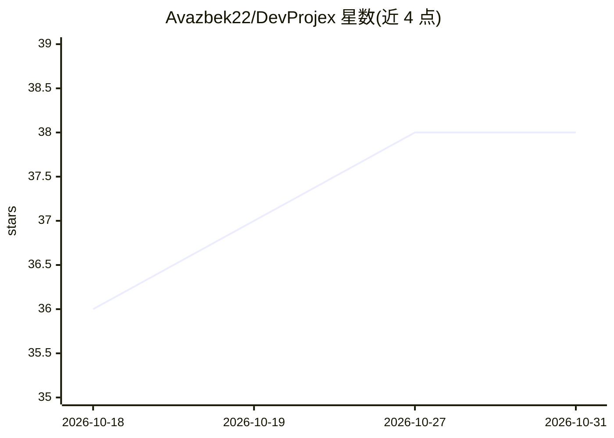

# Avazbek22/DevProjex

⭐ 38 · C# · Apache-2.0 · 推送 2026-10-25 · [GitHub](https://github.com/Avazbek22/DevProjex) · [官网](https://apps.microsoft.com/detail/9ndq3nq5m354) · 个人维护

**把文件夹/Git 仓库变成脱敏、省 token 的 AI 上下文的桌面/TUI/CLI/MCP 工具**

面向使用 AI 编码代理（Claude Code、Codex、Cursor 等）的开发者：将任意本地目录或 Git 仓库转为可勾选、可预览（含 token 估算）的上下文，导出为 ASCII/Markdown/JSON/XML 或文件夹/ZIP 项目副本，也可通过只读 MCP 服务器（8 个工具、Live Context 跟随勾选）供代理读取。内置 Smart Ignore、秘密/隐私数据掩码（MCP 侧不可关闭）、代码压缩、Git 范围限定与代理会话日志。桌面应用跨三平台发布，CLI/TUI/MCP 可经 npm 或 NuGet 直接运行，本地优先、无遥测。

## 筛选速览

| 维度 | 判定 | 备注 |
|---|---|---|
| AI 角色 | `ai-ecosystem` | LLM/agent 周边工具 |
| 许可风险 | `permissive` | Apache-2.0 |
| 部署形态 | `desktop` | 安装包/桌面程序 |
| 模型依赖 | — | README 未给出锁定关系 |
| 硬件要求 | — | 无带数字的原话,不猜 |
| 安装摩擦 | `low` | 无编译、无系统依赖或容器化 |
| 成熟度 | — | 结构信号不足 |

## 能力要点

- 桌面应用、Terminal Workspace、CLI 与只读 MCP 服务器共用同一引擎与掩码管线
- Live Context：桌面端勾选文件即成为代理下一次调用的焦点
- 秘密/PII 掩码、Smart Ignore、代码压缩与 20 语言包注释清理
- 代理会话日志记录每次调用的路径、token 与被掩码值

## 适用场景

- 给 ChatGPT/Claude 对话粘贴干净、脱敏的项目上下文
- 让 Claude Code/Codex/Cursor 通过只读 MCP 服务器按勾选范围读代码
- CI 中当秘密即将泄漏进打包上下文时使构建失败
- 从大型代码库只抽取单个模块供 AI 使用

## 场景标签

 · 领域:开发者工具/AI 上下文工程

## 证据(README 行号)

> L9: DevProjex turns any folder or Git repository into clean context for AI. Paste it into ChatGPT or Claude, or let Clau
> L109: DevProjex ships a built-in **secure Model Context Protocol server**, on the official C# MCP SDK, that turns any lo
> L83: * **Read-only MCP server:** eight tools for any MCP client, on the same engine as the desktop app.

## 星数曲线

2026-10-18 36 → 2026-10-31 38（+2）

---
*卡片 v1 · prompt 1.4 · 生成 2026-10-25 · 置信度 mid · 依据 README sha `e1d556399a1f` · [字段定义](../../DATASET.md)*
