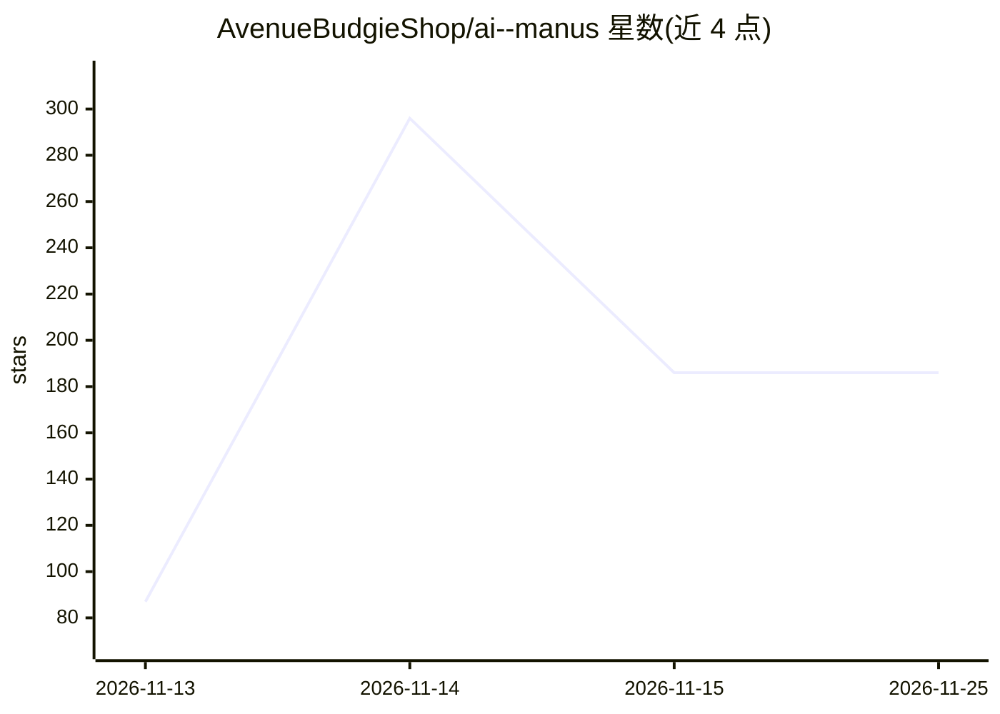

# AvenueBudgieShop/ai--manus

⭐ 186 · Apache-2.0 · 推送 2026-11-15 · [GitHub](https://github.com/AvenueBudgieShop/ai--manus) · 个人维护

**自主 AI Agent：代用户执行代码与控制浏览器完成多步任务**

Manus 是面向家庭、学习与轻量办公场景的自主 AI Agent，用户用自然语言描述需求后由 Agent 规划并执行：可编写并运行脚本、控制浏览器完成网页导航、表单填写与信息收集，支持脚本与浏览器动作在同一流程中衔接，并在多次会话间复用已形成的任务模式。README 仅给出功能介绍、硬件兼容表（最低 4GB 内存、双核 CPU）与使用步骤，未提供安装命令、源码入口或 API 接入方式，属于宣传式文档。

## 筛选速览

| 维度 | 判定 | 备注 |
|---|---|---|
| AI 角色 | `ai-native` | 本体是模型或模型工具 |
| 许可风险 | `permissive` | Apache-2.0 |
| 部署形态 | `None` |  |
| 模型依赖 | — | README 未给出锁定关系 |
| 硬件要求 | — | 无带数字的原话,不猜 |
| 安装摩擦 | `low` | 无编译、无系统依赖或容器化 |
| 成熟度 | — | 结构信号不足 |

## 能力要点

- 自主执行代码：Agent 自行编写并运行脚本完成任务
- 浏览器控制：网页导航、填表、跨页信息收集
- 脚本与浏览器动作可在同一任务流程中衔接
- 面向小规模场景（家庭、学习、轻办公）而非企业平台

## 适用场景

- 让学生整理研究笔记、跑快速计算
- 远程工作者从多个网页收集数据
- 把重复的小型例行任务交给后台 Agent 处理
- 开发时快速做小实验而无需搭建完整环境

## 场景标签

`编码 Agent` `浏览器自动化` `AI 助手` · 领域:效率与自动化

## 证据(README 行号)

> L10: - **Autonomous Code Execution:** Manus AI agent runs code on its own to complete tasks, so you can focus on decisio
> L18: Manus is an autonomous AI agent designed to run code and control a browser on your behalf. Instead of acting like a

## 星数曲线

2026-11-13 87 → 2026-11-25 186（+99）

---
*卡片 v1 · prompt 1.4 · 生成 2026-11-17 · 置信度 mid · 依据 README sha `0f78ee3a5dd2` · [字段定义](../../DATASET.md)*
