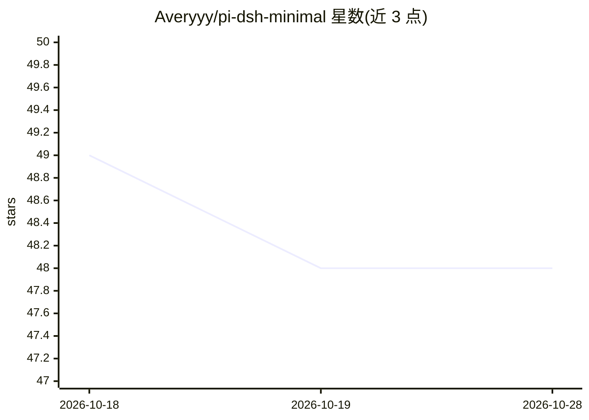

# Averyyy/pi-dsh-minimal

⭐ 48 · TypeScript · NOASSERTION · 推送 2026-08-20 · [GitHub](https://github.com/Averyyy/pi-dsh-minimal) · [官网](https://pi.dev/packages/pi-dsh-minimal) · 个人维护 · 中文 README

**将 DeepSeek V4 模型映射到官方 Harness 最小模式的 Pi 扩展**

面向 Pi 编码代理的扩展：在新会话首个请求时改写系统提示与工具目录，使 DeepSeek V4 Pro/Flash 看到官方 DeepSeek Harness 的两工具（bash + str_replace_editor）最小表面，首个助手回复或工具调用后再恢复 Pi 完整工具集；另将泄露为文本的 DSML 工具调用转换为 Pi 原生调用。附 DeepSWE v1.1 全量 113 任务测量（69/113=61.1%），并列出与官方榜单及 pi 原生基线的对比与样本量限制说明。v0.2.x 的 Flash 弱路由 profile 已在 v0.3.0 移除并给出实验依据。声明为社区项目，非官方 DeepSeek 或 Pi 预设。

## 筛选速览

| 维度 | 判定 | 备注 |
|---|---|---|
| AI 角色 | `ai-ecosystem` | LLM/agent 周边工具 |
| 许可风险 | `none` | NOASSERTION |
| 部署形态 | `None` |  |
| 模型依赖 | locked-api |  |
| 硬件要求 | — | 无带数字的原话,不猜 |
| 安装摩擦 | `low` | 无编译、无系统依赖或容器化 |
| 成熟度 | — | 结构信号不足 |

## 能力要点

- 两阶段表面切换：首请求官方两工具 schema，晋升后恢复 Pi 完整工具集
- DSML 工具调用文本泄漏转换为 Pi 原生工具调用（仅限目录内名称）
- DeepSWE v1.1 全量 113 任务实测数据与失败画像公开
- 不发起网络请求、无遥测

## 适用场景

- 在 Pi 中使用 DeepSeek V4 Pro/Flash 时复现官方 Harness 行为
- 参加 DeepSWE 等 SWE 基准评测时对齐官方任务容器表面
- 通过 /dsh 命令调节启用范围与晋升信号

## 场景标签

`编码 Agent` · 领域:编码与开发

## 证据(README 行号)

> L34: A Pi extension that maps DeepSeek V4 models onto the
> L55: pi install npm:pi-dsh-minimal

## 星数曲线

2026-10-18 49 → 2026-10-28 48（-1）

---
*卡片 v1 · prompt 1.4 · 生成 2026-10-25 · 置信度 high · 依据 README sha `ed539e9bf5b6` · [字段定义](../../DATASET.md)*
