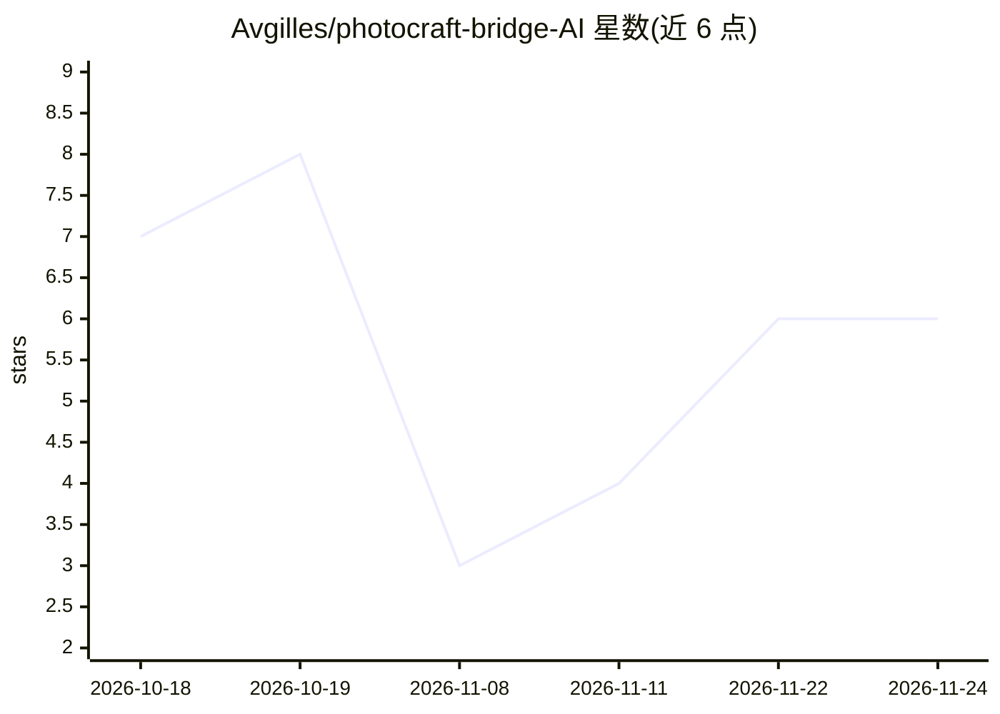

# Avgilles/photocraft-bridge-AI

⭐ 6 · Python · Apache-2.0 · 推送 2026-10-28 · [GitHub](https://github.com/Avgilles/photocraft-bridge-AI) · 个人维护

**把本地 ComfyUI 接入 PhotoCraft，做选区生成填充与移除**

以 xp-photocraft 命令行桥接 PhotoCraft 桌面编辑器与用户自控的 ComfyUI 服务器：在图中选定区域、输入提示词，生成结果以新图层按选区蒙版贴回，选区外像素不动。内置 Qwen Image Edit 工作流，支持拖入从 ComfyUI 导出的 API 图（Flux Fill、SDXL inpainting 等）按标题节点标签（pc:image/pc:prompt/pc:mask 等）接入，也支持 Nano Banana 等云节点。生成期间占位图层可取消，Windows 提供免依赖安装包，Linux 桥接从源码经 uv 安装。

## 筛选速览

| 维度 | 判定 | 备注 |
|---|---|---|
| AI 角色 | `ai-native` | 本体是模型或模型工具 |
| 许可风险 | `permissive` | Apache-2.0 |
| 部署形态 | `desktop` | 安装包/桌面程序 |
| 模型依赖 | — | README 未给出锁定关系 |
| 硬件要求 | — | 无带数字的原话,不猜 |
| 安装摩擦 | `medium` | 含编译或系统依赖之一 |
| 成熟度 | `idea` | |

## 能力要点

- 选区结果以蒙版新图层贴回，非破坏式编辑
- 内置 qwen-edit 工作流，按选区尺寸生成（0.25–1 MP 钳制）
- 支持拖入自导出的 ComfyUI 工作流 JSON 并按动作分配模型
- 生成中占位图层可删除取消，SSH 隧道可连另一台 GPU 机器

## 适用场景

- 在 PhotoCraft 中对选区输入提示词做生成式填充
- 抹除人物/阴影等对象并重建背景
- 用自己导出的 ComfyUI 工作流替换内置模型

## 场景标签

`图像生成` · 领域:内容生成

## 证据(README 行号)

> L4: ComfyUI, with your own workflows.** Select an area in PhotoCraft, type what you want there, and the
> L18: Generation runs on a ComfyUI server you control (this PC, or another PC with a GPU) with any
> L48: - **XP menu** (last in the menu bar): the model each action runs (built-in Qwen Edit 2511, Nano

## 星数曲线

2026-10-18 7 → 2026-11-24 6（-1）

---
*卡片 v1 · prompt 1.4 · 生成 2026-11-22 · 置信度 high · 依据 README sha `32eac6844ad9` · [字段定义](../../DATASET.md)*
