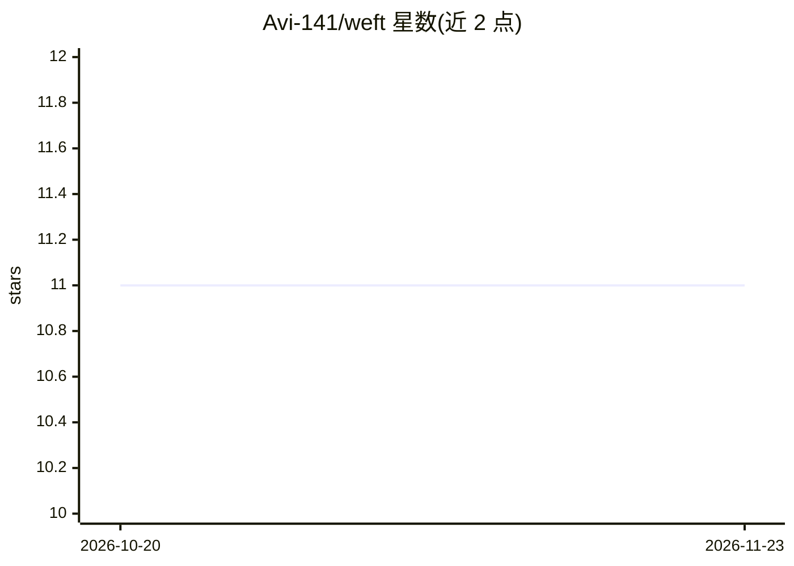

# Avi-141/weft

⭐ 11 · Python · 推送 2026-03-02 · [GitHub](https://github.com/Avi-141/weft) · [官网](https://pypi.org/project/weft-graph/) · 个人维护

**把浏览器标签页构建为本地知识图谱的工具**

Weft 提供两种形态：Chrome 扩展实时追踪浏览并生成可交互图谱，Python CLI 支持批量构建、TUI 浏览、导出 Obsidian 笔记。核心机制是 Louvain 社区发现聚类标签、PageRank 排序、URL 规范化加 SimHash 去重，默认相似度用关键词 Jaccard，可用 Ollama 换成向量嵌入。数据全部本地存储（IndexedDB/JSON），提供 MCP server 暴露浏览上下文给 Claude Desktop 查询。要求 Python 3.9+、macOS 或 Windows。

## 筛选速览

| 维度 | 判定 | 备注 |
|---|---|---|
| AI 角色 | `ai-enhanced` | 去掉 AI 部分产品仍成立 |
| 许可风险 | `permissive` | — |
| 部署形态 | `library` | 以包/库形式分发 |
| 模型依赖 | local-ok | 支持本地模型 |
| 硬件要求 | — | 无带数字的原话,不猜 |
| 安装摩擦 | `low` | 无编译、无系统依赖或容器化 |
| 成熟度 | — | 结构信号不足 |

## 能力要点

- Louvain 社区发现聚类 + PageRank 排序，带 modularity Q 指标
- 两阶段去重：URL 规范化 + SimHash 近重复合并（Hamming 距离 ≤3）
- MCP server 暴露 5 个工具与 3 类资源供 AI 助手查询浏览历史
- 默认 Jaccard 相似度无需 LLM，可选 Ollama 启用向量嵌入聚类

## 适用场景

- 把几十个打开的标签页按主题自动分组整理
- 在 Claude Desktop 里询问自己最近的浏览研究方向
- 把浏览聚类导出为 Obsidian 链接笔记

## 场景标签

`知识图谱` `知识库管理` · 领域:知识与检索

## 证据(README 行号)

> L5: Weft turns browser tabs into a searchable, clustered knowledge graph using Louvain community detection and PageRank.
> L199: |Default|Jaccard similarity on extracted keywords|Always available|
> L222: Weft exposes your browsing context to AI assistants via the Model Context Protocol.

## 星数曲线

2026-10-20 11 → 2026-11-23 11（+0）

---
*卡片 v1 · prompt 1.4 · 生成 2026-11-19 · 置信度 high · 依据 README sha `0f9d5accccb0` · [字段定义](../../DATASET.md)*
