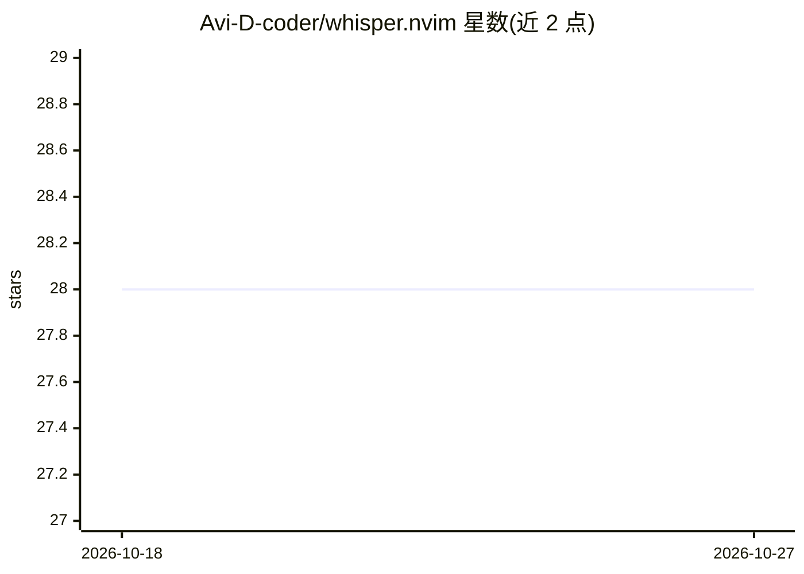

# Avi-D-coder/whisper.nvim

⭐ 28 · Lua · Apache-2.0 · 推送 2025-12-25 · [GitHub](https://github.com/Avi-D-coder/whisper.nvim) · 个人维护

**Neovim 本地语音输入插件：按键录音并转写为文本**

基于 whisper.cpp 的 Neovim 语音转文本插件：按 <C-g> 开关录音，<Space> 触发处理并将转写插入光标处，也可每 20 秒自动插入。首次使用自动下载 whisper base.en 模型（约 148 MB），可选 tiny.en/small.en。需 Neovim ≥ 0.8.0 与 whisper-cpp（whisper-stream）二进制，提供三个 CPU/电池性能档位（step_ms 20000/5000/3000）、Lualine 状态显示与 :WhisperToggle、:WhisperDownloadModel 等命令及 checkhealth 健康检查。

## 筛选速览

| 维度 | 判定 | 备注 |
|---|---|---|
| AI 角色 | `ai-native` | 本体是模型或模型工具 |
| 许可风险 | `permissive` | Apache-2.0 |
| 部署形态 | `None` |  |
| 模型依赖 | — | README 未给出锁定关系 |
| 硬件要求 | — | 无带数字的原话,不猜 |
| 安装摩擦 | `low` | 无编译、无系统依赖或容器化 |
| 成熟度 | — | 结构信号不足 |

## 能力要点

- 按键录音、光标处插入转写，支持 20 秒自动插入
- 首次使用自动下载 whisper base.en 模型（~148 MB），可选 tiny/small.en
- 三档 step_ms 性能调优（电池/交互/实时）
- Lualine 集成显示录音状态，:checkhealth whisper 健康检查

## 适用场景

- 在 Neovim 中用语音代替打字输入文本
- 写作或备注时边说边录、自动插入转写
- 本地离线转写，不依赖云端服务

## 场景标签

`语音识别` · 领域:感知与多模态

## 证据(README 行号)

> L3: Speech-to-text for Neovim using whisper.cpp.
> L5: Press `<C-g>` to toggle recording. Press `<Space>` to process and insert transcription at your cursor.

## 星数曲线

2026-10-18 28 → 2026-10-27 28（+0）

---
*卡片 v1 · prompt 1.4 · 生成 2026-10-26 · 置信度 high · 依据 README sha `a47f3d88a24d` · [字段定义](../../DATASET.md)*
