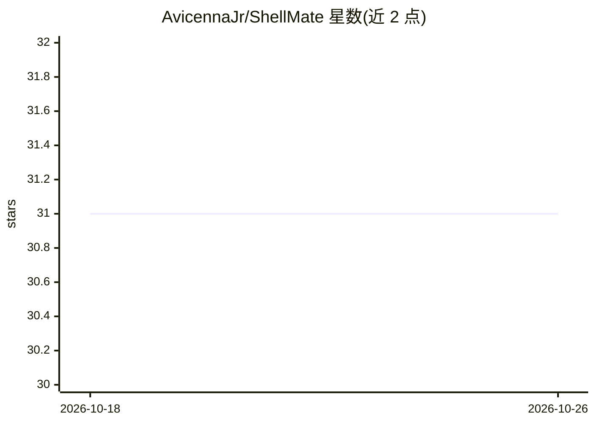

# AvicennaJr/ShellMate

⭐ 31 · Go · GPL-2.0 · 推送 2026-08-13 · [GitHub](https://github.com/AvicennaJr/ShellMate) · 个人维护

**终端 AI 助手：在命令行调用 OpenAI 回答问题**

用 Go 编写的命令行 AI 助手，用户在终端运行程序与 OpenAI 模型对话获取回答。使用前需在 OpenAI 创建账号并生成 API token，通过环境变量传入或在运行时手动输入。Linux 与 Windows 可从 release 页下载二进制文件直接运行；macOS 需从源码编译，要求本机安装 Go 后 git clone 并 go build。

## 筛选速览

| 维度 | 判定 | 备注 |
|---|---|---|
| AI 角色 | `ai-native` | 本体是模型或模型工具 |
| 许可风险 | `viral` | GPL-2.0 |
| 部署形态 | `desktop` | 安装包/桌面程序 |
| 模型依赖 | — | README 未给出锁定关系 |
| 硬件要求 | — | 无带数字的原话,不猜 |
| 安装摩擦 | `low` | 无编译、无系统依赖或容器化 |
| 成熟度 | — | 结构信号不足 |

## 能力要点

- 终端中调用 OpenAI API 的 AI 助手
- Linux/Windows 提供预编译二进制，macOS 需源码构建
- OpenAI token 支持环境变量或运行时手动输入

## 适用场景

- 在终端里直接向 AI 提问获取回答
- 不想离开命令行环境的开发者快速查询

## 场景标签

`AI 助手` · 领域:对话与助手

## 证据(README 行号)

> L2:  Your Very Own Terminal AI Assistant
> L10: - First create an account on OpenAI and create a new token key.

## 星数曲线

2026-10-18 31 → 2026-10-26 31（+0）

---
*卡片 v1 · prompt 1.4 · 生成 2026-10-26 · 置信度 mid · 依据 README sha `489d8ddff396` · [字段定义](../../DATASET.md)*
