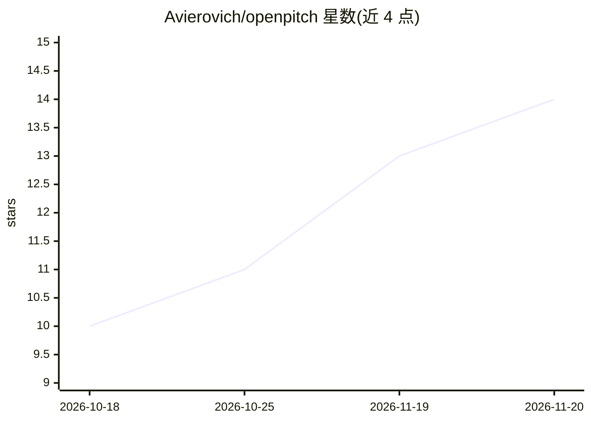

# Avierovich/openpitch

⭐ 14 · Python · MIT · 推送 2026-11-19 · [GitHub](https://github.com/Avierovich/openpitch) · [官网](https://avierovich.github.io/openpitch/) · 个人维护

**给投资人与 agent 使用的开源 AI 创业公司情报数据源**

提供 AI 初创公司的公开来源情报：每日 pipeline 抓取播客、新闻、SEC EDGAR、网页，转录提取融资与 ARR 等指标，经冲突调和、来源评分后以 git 提交作为数据库发布。接口为只读 MCP server、静态 dashboard、JSONL 事件流与 A2A agent card，每个数字附带来源、置信度与版本历史。数据为概率性估计，不做尽调级核验，明确声明非投资建议。MIT 许可，无需 API key。

## 筛选速览

| 维度 | 判定 | 备注 |
|---|---|---|
| AI 角色 | `ai-knowledge` | 知识聚合/清单类 |
| 许可风险 | `permissive` | MIT |
| 部署形态 | `library` | 以包/库形式分发 |
| 模型依赖 | — | README 未给出锁定关系 |
| 硬件要求 | — | 无带数字的原话,不猜 |
| 安装摩擦 | `low` | 无编译、无系统依赖或容器化 |
| 成熟度 | — | 结构信号不足 |

## 能力要点

- 每个数字带来源链接、置信度分数与 git 版本历史
- MCP server 可被 Claude Code/Codex 等 agent 直接调用
- 每日 pipeline 自动抓取、调和冲突并发布
- 支持订阅 typed events 的组合式接入与 A2A 发现

## 适用场景

- 向 agent 询问某 AI 公司估值/融资并要求给出处
- 搭建简报或 PR agent 订阅其事件流
- 投资前先看免费的公开来源初查信息

## 场景标签

`金融量化` · 领域:学习与行业

## 证据(README 行号)

> L121: The git repo **is** the database. There's no server to run. See the FRD for the full design.
> L53: - 🕒 **Version-tracked** — the git history *is* the audit log. See exactly how a company's reported ARR evolved.
> L153: **Global AI startups** — **140+ profiled** across 12 sectors (including Chinese AI labs and European names Western

## 星数曲线

2026-10-18 10 → 2026-11-20 14（+4）

---
*卡片 v1 · prompt 1.4 · 生成 2026-11-19 · 置信度 high · 依据 README sha `6de673d87252` · [字段定义](../../DATASET.md)*
