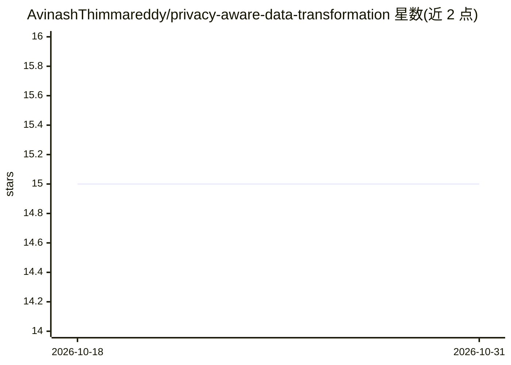

# AvinashThimmareddy/privacy-aware-data-transformation

⭐ 15 · Python · Apache-2.0 · 推送 2026-01-11 · [GitHub](https://github.com/AvinashThimmareddy/privacy-aware-data-transformation) · 个人维护

**给科研/数据工程：数据管道中敏感数据自动分类与脱敏框架**

开源研究框架：从 YAML 元数据（列名、描述、表信息）自动将字段分类为 PII/PHI/Sensitive/Non-Sensitive，再按数据敏感度、消费方身份（内部分析师/外部伙伴/报表/公开）与用途动态应用 Keep/Mask/Hash/Tokenize/Aggregate 五类隐私变换。分类采用规则匹配为主、可选 LogisticRegression+TF-IDF ML 分类器（在用户元数据上训练）为辅的两阶段方法。以 Python 包与 CLI 形式提供，纯本地执行，变换单向不可逆，聚合变换尚未完全实现。

## 筛选速览

| 维度 | 判定 | 备注 |
|---|---|---|
| AI 角色 | `ai-native` | 本体是模型或模型工具 |
| 许可风险 | `permissive` | Apache-2.0 |
| 部署形态 | `library` | 以包/库形式分发 |
| 模型依赖 | — | README 未给出锁定关系 |
| 硬件要求 | — | 无带数字的原话,不猜 |
| 安装摩擦 | `low` | 无编译、无系统依赖或容器化 |
| 成熟度 | — | 结构信号不足 |

## 能力要点

- 元数据驱动的敏感度分类（PII/PHI/Sensitive/Non-Sensitive 四类）
- 两阶段分类：规则匹配为主 + 可训练的 LogisticRegression+TF-IDF ML 分类器
- 按消费方身份的策略引擎：Tokenize/Hash/Mask/Aggregate/Keep 五种变换
- 提供 Python API、CLI 与示例脚本，合成数据实验、固定随机种子可复现

## 适用场景

- 数据管道中自动识别敏感字段并按消费方差异化脱敏
- 研究隐私-效用权衡的脱敏策略实验
- 为不同数据消费方（分析师/外部伙伴/报表）生成不同脱敏版本的数据集

## 场景标签

 · 领域:数据隐私/数据工程

## 证据(README 行号)

> L29: ### 1. Automated Sensitive Data Classification
> L183: ## 🤖 Machine Learning Classifier

## 星数曲线

2026-10-18 15 → 2026-10-31 15（+0）

---
*卡片 v1 · prompt 1.4 · 生成 2026-10-31 · 置信度 high · 依据 README sha `03f76b4459f5` · [字段定义](../../DATASET.md)*
