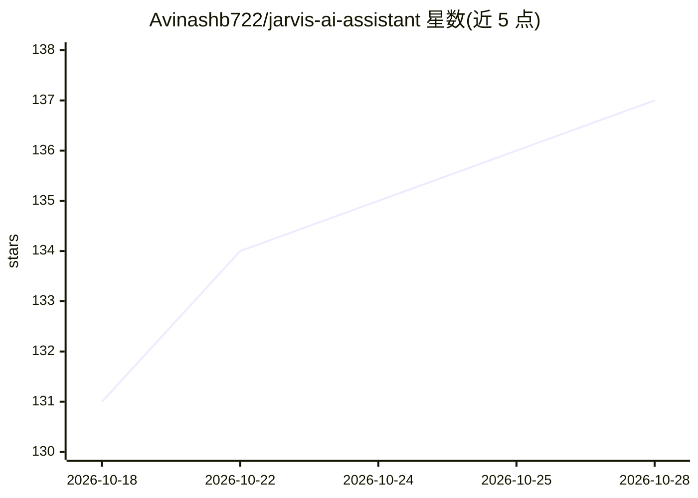

# Avinashb722/jarvis-ai-assistant

⭐ 137 · Python · MIT · 推送 2026-07-21 · [GitHub](https://github.com/Avinashb722/jarvis-ai-assistant) · [官网](https://noriaai.tech/) · 个人维护

**面向个人用户的语音/人脸认证桌面 AI 虚拟助手**

用 Python 与 Eel 网页界面构建的个人虚拟助手：通过 Groq 与 Google Gemini 双 AI 通道处理自然语言，支持语音识别、TTS、唤醒词与持续监听；用 OpenCV 做人脸认证，经 ADB 集成 Android 手机（短信、来电提醒、WhatsApp、远程控制），并提供系统控制（应用/文件/截图/定时任务）与网页控制面板。需配置 API key，主要面向 Windows 10/11，麦克风与摄像头为语音及人脸功能所需硬件，手机功能需 USB 调试与 ADB。

## 筛选速览

| 维度 | 判定 | 备注 |
|---|---|---|
| AI 角色 | `ai-native` | 本体是模型或模型工具 |
| 许可风险 | `permissive` | MIT |
| 部署形态 | `library` | 以包/库形式分发 |
| 模型依赖 | locked-api |  |
| 硬件要求 | — | 无带数字的原话,不猜 |
| 安装摩擦 | `low` | 无编译、无系统依赖或容器化 |
| 成熟度 | — | 结构信号不足 |

## 能力要点

- Groq + Google Gemini 双 AI 提供方，含回退机制
- OpenCV 人脸认证 + ADB 指纹双因素认证
- 语音命令、唤醒词（Hey Jarvis）与持续监听
- 经 ADB 的 Android 手机集成：短信、来电、WhatsApp、远程控制

## 适用场景

- 用语音命令控制电脑：开关应用、截图、查系统状态
- 通过人脸与指纹双因素认证后使用助手
- 在电脑上读取/发送短信与 WhatsApp 消息、接收来电提醒

## 场景标签

`AI 助手` `语音 Agent` · 领域:对话与助手

## 证据(README 行号)

> L18: The assistant leverages multiple AI providers (Groq, Google Gemini) for natural language processing and provides a 
> L35: - **Groq AI**: Fast language model processing
> L16: JARVIS AI Assistant is a sophisticated virtual assistant that combines cutting-edge AI technologies with practical 

## 星数曲线

2026-10-18 131 → 2026-10-28 137（+6）

---
*卡片 v1 · prompt 1.4 · 生成 2026-10-23 · 置信度 mid · 依据 README sha `096c0b9c5c1a` · [字段定义](../../DATASET.md)*
