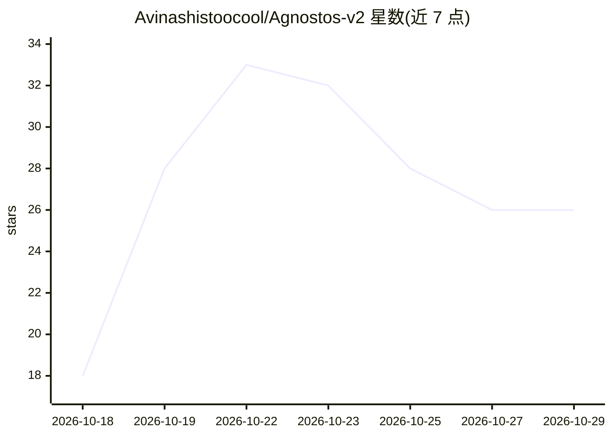

# Avinashistoocool/Agnostos-v2

⭐ 26 · Python · MIT · 推送 2026-10-27 · [GitHub](https://github.com/Avinashistoocool/Agnostos-v2) · 个人维护

**面向学生的科研实习套磁 CLI：匹配教授、代拟并分批发送邮件**

Python 命令行工具，面向寻找科研实习的学生。读取用户简历与目标教授表格，用本地 NLP 免费打分排序，经 OpenAlex 免费检索教授近期论文，预测接收概率并用 LLM 为每位教授生成定制化冷邮件，按教授工作时段经 SMTP 限速发送，可跟踪回复并代拟答复。默认 LLM 提供商为 Groq 免费额度，支持 OpenAI 及兼容网关；也可仅从研究主题批量发现并去重教授名单。成本门控与花费上限可在 LLM 调用前人工确认。

## 筛选速览

| 维度 | 判定 | 备注 |
|---|---|---|
| AI 角色 | `ai-native` | 本体是模型或模型工具 |
| 许可风险 | `permissive` | MIT |
| 部署形态 | `library` | 以包/库形式分发 |
| 模型依赖 | locked-api |  |
| 硬件要求 | — | 无带数字的原话,不猜 |
| 安装摩擦 | `low` | 无编译、无系统依赖或容器化 |
| 成熟度 | — | 结构信号不足 |

## 能力要点

- 本地 NLP 免费匹配排序 + OpenAlex 免费论文检索的前置过滤
- 分批 discover 构建教授名单，按 OpenAlex id 与姓名去重、断点续跑
- 为每位教授生成定制冷邮件，经 SMTP 限速分批发送并回写 xlsx
- 默认 Groq 免费额度，--budget 花费上限与 [Y/N] 成本门控

## 适用场景

- 我有一份目标教授表格，想按简历匹配度排序并生成定制套磁邮件
- 我只有研究方向，想自动发现并整理一批相关领域的教授名单
- 我想在自己的邮箱里按节奏分批发出套磁信并跟踪回复

## 场景标签

`科研工具` · 领域:学习与行业

## 证据(README 行号)

> L3: **Agnostos** is a free, open-source tool that helps students land research internships. It finds professors whose re
> L7: An autonomous, token-efficient pipeline for research internship outreach. Agnostos matches your CV against prospecti
> L19: **It costs nothing.** The default provider is Groq, whose free tier comfortably covers a full run. OpenAI (or any O

## 星数曲线

2026-10-18 18 → 2026-10-29 26（+8）

---
*卡片 v1 · prompt 1.4 · 生成 2026-10-26 · 置信度 mid · 依据 README sha `7ebf40cd3cfe` · [字段定义](../../DATASET.md)*
