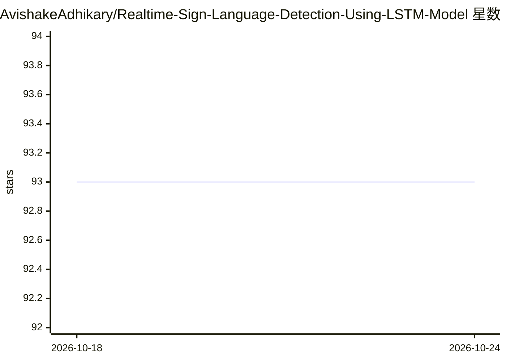

# AvishakeAdhikary/Realtime-Sign-Language-Detection-Using-LSTM-Model

⭐ 93 · Jupyter Notebook · MIT · 推送 2025-11-18 · [GitHub](https://github.com/AvishakeAdhikary/Realtime-Sign-Language-Detection-Using-LSTM-Model) · 个人维护

**基于 LSTM 的实时手语手势识别项目，面向听障辅助沟通**

深度学习项目：从摄像头视频流中采集手语手势，使用 LSTM 神经网络学习并分类手势，实现实时检测与解读；基于 Python、TensorFlow、OpenCV 和 Numpy 构建，以 Jupyter Notebook（RealTimeSignLanguageDetection.ipynb）形式交付，克隆仓库并安装依赖后运行全部单元格即可使用。支持添加并训练新手势，可适配不同语言的手势体系。定位为听障人群的辅助沟通技术。未提供打包模型之外的安装包或 Docker 镜像。

## 筛选速览

| 维度 | 判定 | 备注 |
|---|---|---|
| AI 角色 | `ai-native` | 本体是模型或模型工具 |
| 许可风险 | `permissive` | MIT |
| 部署形态 | `library` | 以包/库形式分发 |
| 模型依赖 | — | README 未给出锁定关系 |
| 硬件要求 | — | 无带数字的原话,不猜 |
| 安装摩擦 | `low` | 无编译、无系统依赖或容器化 |
| 成熟度 | — | 结构信号不足 |

## 能力要点

- LSTM 网络实时识别摄像头视频流中的手语手势
- 支持添加并训练新手势，可适配不同语言的手语
- 基于 TensorFlow/OpenCV/Numpy，以 Jupyter Notebook 交付
- 包含 h5 格式模型文件

## 适用场景

- 为听障人士搭建实时手语翻译的辅助沟通工具
- 在自己的项目中集成手语手势识别能力
- 作为 LSTM 时序动作识别的学习与实验项目

## 场景标签

`图像视频处理` · 领域:感知与多模态

## 证据(README 行号)

> L5: > The Realtime Sign Language Detection Using LSTM Model is a deep learning-based project that aims to recognize and 
> L68: Simply run all the cells inside the 'RealTimeSignLanguageDetection.ipynb' file.

## 星数曲线

2026-10-18 93 → 2026-10-24 93（+0）

---
*卡片 v1 · prompt 1.4 · 生成 2026-10-23 · 置信度 mid · 依据 README sha `335c6ec9f829` · [字段定义](../../DATASET.md)*
